<table class="sphinxhide" width="100%">
 <tr width="100%">
    <td align="center"><h1>xSPI HyperRAM Design Tutorials</h1>
    <a href="https://www.amd.com/en/products/software/adaptive-socs-and-fpgas/vivado.html">See AMD Vivado™ Design Environment on amd.com</a>
    </td>
 </tr>
</table>

# Module 01: xSPI HyperRAM Basic Design

***Version: Vivado 2026.1***

## Introduction

xSPI HyperRAM™ is a JEDEC-compliant serial memory solution that delivers high bandwidth with a low pin count and simple system integration. It provides a cost-efficient and power-efficient external RAM option for FPGAs and edge systems, enabling high-performance memory without DDR complexity. The AXI xSPI IP provides a unified, standards-compliant controller that enables efficient, scalable system memory for modern edge designs.

This tutorial demonstrates how to create a complete design that uses an AXI Traffic Generator (ATG) to stress-test an xSPI HyperRAM controller on the SCU35 board. A VIO core provides runtime start/stop control of the traffic generator, and a System ILA is included for real-time AXI bus monitoring via JTAG.

## Description of the Design

This design uses an AXI Traffic Generator in **Data Mode** to write and read data to/from an external HyperRAM device via the AXI xSPI controller. The design includes:

- A **Clocking Wizard** to generate 200 MHz (system) and 400 MHz (xSPI) clocks from the board differential clock
- A **Processor System Reset** to synchronize resets across clock domains
- An **AXI Traffic Generator** configured for continuous 50/50 read/write traffic with random addressing
- A **VIO (Virtual I/O)** core to control ATG start/stop signals via JTAG at runtime
- A **SmartConnect** for AXI protocol handling between ATG and xSPI
- An **AXI xSPI** controller configured for HyperRAM in XIP performance mode
- A **System ILA** to monitor AXI transactions in hardware

The design is controlled via VIO — after programming, the user asserts `core_ext_start` through the VIO to begin traffic generation, and can halt it with `core_ext_stop`. No software or processor is required.

### Block Diagram

```
                       ┌──────────────┐
                       │    VIO       │
                       │ (Start/Stop) │
                       └──────┬───────┘
                              │ core_ext_start / core_ext_stop
┌────────────────┐     ┌──────▼───────┐     ┌────────────┐      ┌──────────┐
│  Clocking      │     │  AXI Traffic │     │ Smart      │      │  AXI     │
│  Wizard        │───▶│  Generator    │────▶│ Connect   │────▶│  xSPI    │───▶ HyperRAM
│  (200/400 MHz) │     │  (Data Mode) │     │  (1→1)     │      │          │
└────────────────┘     └──────┬───────┘     └────────────┘      └──────────┘
                              │
                       ┌──────▼───────┐
                       │  System ILA  │
                       │  (AXI Mon)   │
                       └──────────────┘
```

### Design Specifications

| Parameter | Value |
|-----------|-------|
| Target Part | `xcsu35p-sbvb625-2-e` |
| Board | `xilinx.com:scu35:part0:2.0` |
| System Clock | 200 MHz |
| xSPI Clock | 400 MHz (200 MHz DDR SCK) |
| AXI Data Width | 32-bit |
| Address Range | 0x00000000–0x007FFFFF (8 MB) |
| Traffic Pattern | 50% Read / 50% Write, Fixed, max 16-byte bursts |
| ILA Depth | 1024 samples (~20 µs capture) |
| VIO Controls | `init_done` (probe_in0), `core_ext_start` (probe_out0), `core_ext_stop` (probe_out1) |

---

## Create the Project

### Start the Vivado Design Suite

1. Open the AMD Vivado™ Design Suite 2026.1.
2. Click **New Project** from the Quick Start menu.
3. In the Project Name page, specify the name `atg_hyperram_proj`.
4. Step through the popup menus to access the Default Part page.
5. In the Default Part page, click the **Boards** tab, search for "scu35" and select: `Spartan UltraScale+ SCU35 Evaluation Platform`.
6. Continue to the Finish stage to create the new project and open Vivado.
7. In the Vivado Flow Navigator, click **IP Integrator → Create Block Design**. A popup dialog box displays to create the block design. Type `design_1` in the Design name field.
8. Click **OK**. An empty block design diagram canvas opens.

The Tcl commands for the above steps to create the project and initial block design are as follows:

```tcl
create_project atg_hyperram_proj ./atg_hyperram_proj -part xcsu35p-sbvb625-2-e -force
set_property board_part xilinx.com:scu35:part0:2.0 [current_project]
create_bd_design "design_1"
```

---

## Instantiate IP and Configure the Design

### Step 1: Add the AXI xSPI Controller

The AXI xSPI IP provides a high-performance HyperRAM memory controller with an AXI4 Full slave interface. It handles the HyperBus protocol, DDR data transfer, and read latency management.

1. Add IP → search for `AXI xSPI` and instantiate.
2. Double-click `axi_xspi_0` to configure:

| Field | Setting | Purpose |
|-------|---------|---------|
| Enable Performance Mode | 1 (Enabled) | Optimized execute-in-place access |
| AXI Lite Interface | 0 (Disabled) | Use AXI4 Full only — no register config needed |
| External SPI Clock Freq | Enabled, 400 MHz | DDR clock source |
| Frequency Ratio | 2 | 400 ÷ 2 = 200 MHz SCK |
| Hardware Reset | 1 (Enabled) | Drive HyperRAM RESET# pin |
| TXFIFO and RXFIFO Depth | 256 | Deep buffering for burst transactions |
| Target Latency | 7 | HyperRAM initial access latency (per datasheet) |


3. Click **OK**.

```tcl
create_bd_cell -type ip -vlnv xilinx.com:ip:axi_xspi:1.0 axi_xspi_0
set_property -dict [list \
    CONFIG.C_AXI_LITE_INTERFACE {0} \
    CONFIG.C_EXT_SPI_CLK_FREQ {400} \
    CONFIG.C_SCK_RATIO {2} \
    CONFIG.C_FIFO_DEPTH {256} \
    CONFIG.C_TGT_LATENCY {7} \
    CONFIG.C_XIP_PERF_MODE {1} \
    CONFIG.C_ENABLE_HWRESET {1} \
    CONFIG.C_ENABLE_DEBUG {0} \
] [get_bd_cells axi_xspi_0]
```

---


### Step 2: Add the AXI Traffic Generator

The AXI Traffic Generator (ATG) is an autonomous traffic source that generates AXI4 memory-mapped transactions. It is configured in High Level Traffic (HLT) Data Mode to produce a continuous stream of read and write transactions. Start and stop are controlled externally via VIO.

1. Add IP → search for `AXI Traffic Generator` and instantiate.
2. Double-click `axi_traffic_gen_0` to configure:

| Tab/Field | Setting | Purpose |
|-----------|---------|---------|
| ATG Options | High Level Traffic | Data-mode traffic generation |
| Traffic Profile | Data | Standard memory R/W operations |
| AXI Master Width | 32 | Matches xSPI data width |
| AXI Base Address | 0x00010000 | Start of xSPI address map |
| AXI High Address | 0x007FFFFF | HyperRAM address window |
| Traffic Gen | Repetitive | Runs continuously |
| Traffic Pattern | Fixed | Fixed addressing within range |
| Transfer Length (Avg) | 16 | Max 16 bytes per burst (4 beats) |
| Data Size Max | 16 | Maximum transfer size |
| Transaction Type | Read_Write | Exercise both paths |
| Read Share | 50 | 50% reads |
| Write Share | 50 | 50% writes |
| Inter Transaction Gap | Fixed, 20 | 20 clock gap between bursts |


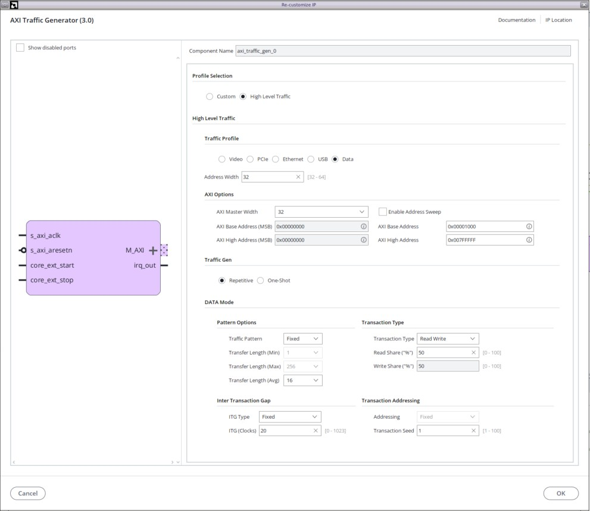


3. Click **OK**.

```tcl
create_bd_cell -type ip -vlnv xilinx.com:ip:axi_traffic_gen:3.0 axi_traffic_gen_0
set_property -dict [list \
    CONFIG.ATG_OPTIONS {High Level Traffic} \
    CONFIG.TRAFFIC_PROFILE {Data} \
    CONFIG.MASTER_AXI_WIDTH {32} \
    CONFIG.MASTER_BASE_ADDRESS {0x00010000} \
    CONFIG.MASTER_HIGH_ADDRESS {0x007FFFFF} \
    CONFIG.ATG_HLT_CH_SELECT {Read_Write} \
    CONFIG.C_ATG_REPEAT_TYPE {Repetitive} \
    CONFIG.DATA_TRAFFIC_PATTERN {Fixed} \
    CONFIG.DATA_SIZE_AVG {16} \
    CONFIG.DATA_READ_SHARE {50} \
    CONFIG.DATA_WRITE_SHARE {50} \
    CONFIG.DATA_TRANS_GAP {Fixed} \
    CONFIG.DATA_ITG_GAP {20} \
    CONFIG.DATA_TRANS_SEED {1} \
    CONFIG.C_ATG_STATIC_HLTP_INCR {0} \
] [get_bd_cells axi_traffic_gen_0]
```

---


### Step 3: Add VIO (Virtual I/O)

The VIO core provides JTAG-based runtime control of the ATG. It exposes two output probes to start and stop traffic generation without requiring a processor or software.

1. Add IP → search for `VIO` and instantiate.
2. Double-click `vio_0` to configure:
   - Number of Input Probes: `1`
   - Number of Output Probes: `2`
   - Probe_in0 Width: 1 (maps to `init_done`)
   - Probe_out0 Width: 1 (maps to `core_ext_start`)
   - Probe_out1 Width: 1 (maps to `core_ext_stop`)


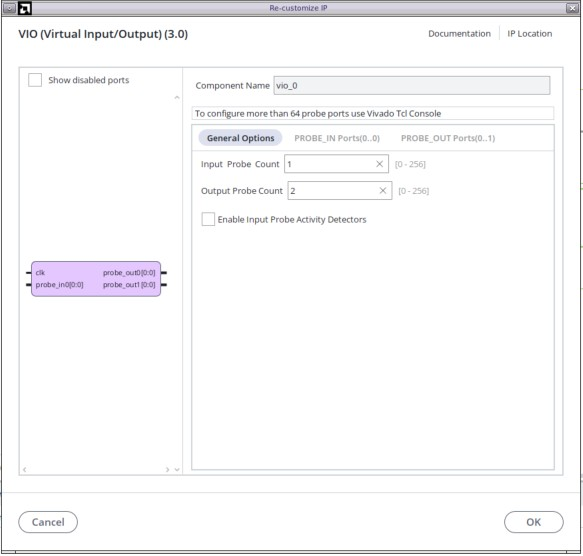


3. Click **OK**.

```tcl
create_bd_cell -type ip -vlnv xilinx.com:ip:vio:3.0 vio_0
set_property -dict [list \
    CONFIG.C_NUM_PROBE_IN {1} \
    CONFIG.C_NUM_PROBE_OUT {2} \
] [get_bd_cells vio_0]
```

4. Make the following connections:<br>
 a. Connect `Probe_in0` to the 'init_done' signal of xSPI IP core.<br>
 b. Connect `Probe_out0` to 'core_ext_start' signal of AXI Traffic Generator<br>
 c. Connect `Probe_out1` to 'core_ext_stop' signal of AXI Traffic Generator<br>


> **Note:** After programming the FPGA, open the Hardware Manager VIO dashboard. Wait until init_done status becomes 1 and set `probe_out0` HIGH to start ATG traffic, and set `probe_out1` HIGH to stop it. This gives full interactive control over the traffic pattern.


### Step 4: Add Clocking Wizard

The Clocking Wizard generates the system and xSPI clocks from the board differential clock input.

1. Add IP → search for `Clocking Wizard` and instantiate.
2. Double-click `clk_wiz_0` to configure. 
3. Go to the **Board** tab:
    - CLK_IN1: sys diff clock
    - EXT_RESET_IN: reset
4. Go to the **Clocking Options** tab:
    - Primary clock Source: Differential clock capable pin
5. Go to the **Output Clocks** tab:
    - clk_out1: 200 MHz
    - clk_out2: 400 MHz
    - Reset Type: Active Low
    
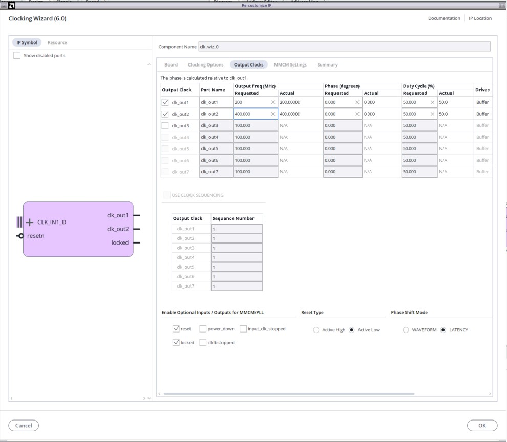

Connect 'clk_out2' (400MHz) to the 'ext_spi_clk' signal of Axi xSPI IP.

---

## Block Design

Click the **Run Connection Automation** link. The Run Connection Automation dialog box opens. Select **All Automation** with all the default options set, then click **OK**.

This action adds the SmartConnect, clock, and reset infrastructure and makes all the connections. select XSPI_0 bus on xSPI IP and make it external. 
Verify that the generated block diagram matches the following figure.

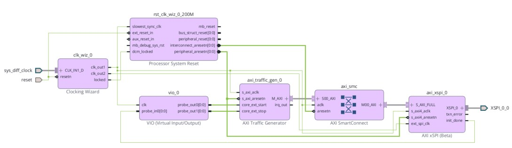

###  Add System ILA

The System ILA provides non-intrusive real-time monitoring of AXI transactions via JTAG. It captures full AXI protocol activity including addresses, data, and responses.

1. Add IP → search for `System ILA` and instantiate.
2. Double-click to configure:
   - Number of Interface Slots: `2`
   - Sample Data Depth: `1024`
   - Slot 0 Interface Type: `xilinx.com:interface:aximm_rtl:1.0`
   - Slot 1 Interface Type: `xilinx.com:interface:aximm_rtl:1.0`


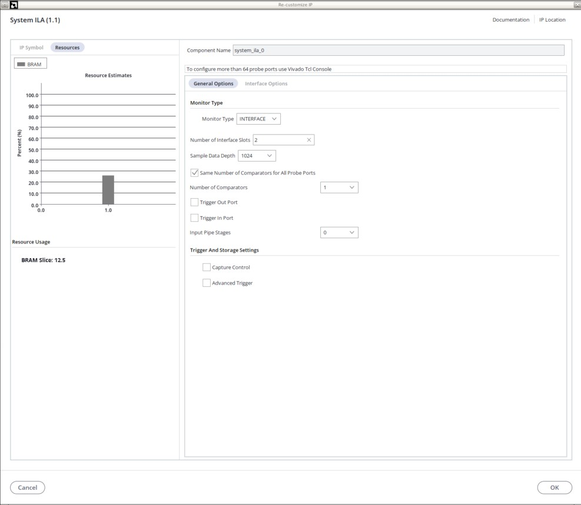


3. Click **OK**.

```tcl
create_bd_cell -type ip -vlnv xilinx.com:ip:system_ila:1.1 system_ila_0
set_property -dict [list \
    CONFIG.C_NUM_MONITOR_SLOTS {2} \
    CONFIG.C_SLOT_0_INTF_TYPE {xilinx.com:interface:aximm_rtl:1.0} \
    CONFIG.C_SLOT_1_INTF_TYPE {xilinx.com:interface:aximm_rtl:1.0} \
    CONFIG.C_DATA_DEPTH {1024} \
] [get_bd_cells system_ila_0]
```
4. Connect Slot 0 interface to AXI Traffic Generator M_AXI bus interface. 
5. Connect Slot 1 interface to AXI SmartConnect M00_AXI bus interface. 


After adding ILA, the block diagram shown below

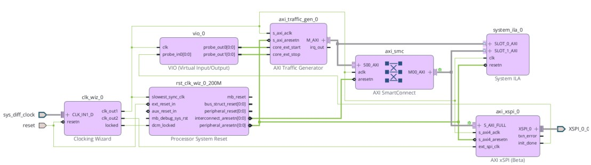 

---

## Address Map

Open the **Address Editor** tab to assign addresses to the memory-mapped peripherals.

1. Right-click in the Address Editor window and select **Assign All**.
2. Modify the Master Base Address of xSPI ip to "0x00000000" and set the range to '8MB'. 
3. The xSPI controller is mapped to address `0x00000000` with an 8 MB range, matching the ATG's configured base address.

| Master | Slave Segment | Base Address | Range |
|--------|---------------|--------------|-------|
| axi_traffic_gen_0/Data | axi_xspi_0/aximm/Mem | 0x00000000 | 8M |

```tcl
assign_bd_address
set_property offset 0x00000000 [get_bd_addr_segs {axi_traffic_gen_0/Data/SEG_axi_xspi_0_Mem}]
set_property range 8M [get_bd_addr_segs {axi_traffic_gen_0/Data/SEG_axi_xspi_0_Mem}]
```

> **Note:** The ATG's `MASTER_BASE_ADDRESS` (0x00010000) and `MASTER_HIGH_ADDRESS` (0x007FFFFF) must encompass the assigned address range of the xSPI controller. The actual xSPI memory segment is 8MB at 0x00000000–0x007FFFFF. If the addresses do not overlap, the ATG transactions will receive DECERR (decode error) responses.

---

## Validate the Block Design

Validation checks the design for connectivity errors, clock domain issues, and address conflicts.

1. Right-click on the canvas and select **Validate Design**, or click the Validate Design icon (✓) in the toolbar.
2. Resolve any errors or warnings before proceeding.
3. Save the design with **Ctrl+S**.

```tcl
validate_bd_design
save_bd_design 
```

---

## Create the HDL Wrapper

A top-level HDL wrapper must be created to instantiate the block design for synthesis and implementation.

1. Open the **Sources** window → **Hierarchy** tab.
2. Under **Design Sources**, right-click `design_1.bd` and select **Create HDL Wrapper...**
3. Select **Let Vivado manage wrapper and auto-update**.
4. Click **OK**.

```tcl
make_wrapper -files [get_files design_1.bd] -top
add_files -norecurse [glob *design_1_wrapper.v]
update_compile_order -fileset sources_1
```

---

## Add Constraints

### Pin Assignments

Create a constraints file with the HyperRAM pin assignments for the SCU35 board. These map the xSPI memory interface signals to the physical FPGA pins connected to the HyperRAM device.

1. In the Flow Navigator, click **Add Sources → Add or create constraints**.
2. Click **Create File**, name it `pin.xdc`, and add the following content:

```xdc
# ============================================================
# xSPI HyperRAM Pin Assignments - SCU35 Board
# ============================================================

# Chip Select
set_property PACKAGE_PIN C22 [get_ports {XSPI_0_0_cs[0]}]
set_property IOSTANDARD LVCMOS18 [get_ports {XSPI_0_0_cs[0]}]

# Data Strobe
set_property PACKAGE_PIN B23 [get_ports XSPI_0_0_ds]
set_property IOSTANDARD LVCMOS18 [get_ports XSPI_0_0_ds]

# Data IO[0:7]
set_property PACKAGE_PIN C20 [get_ports XSPI_0_0_io0]
set_property IOSTANDARD LVCMOS18 [get_ports XSPI_0_0_io0]
set_property PACKAGE_PIN B20 [get_ports XSPI_0_0_io1]
set_property IOSTANDARD LVCMOS18 [get_ports XSPI_0_0_io1]
set_property PACKAGE_PIN A23 [get_ports XSPI_0_0_io2]
set_property IOSTANDARD LVCMOS18 [get_ports XSPI_0_0_io2]
set_property PACKAGE_PIN A24 [get_ports XSPI_0_0_io3]
set_property IOSTANDARD LVCMOS18 [get_ports XSPI_0_0_io3]
set_property PACKAGE_PIN A20 [get_ports XSPI_0_0_io4]
set_property IOSTANDARD LVCMOS18 [get_ports XSPI_0_0_io4]
set_property PACKAGE_PIN A21 [get_ports XSPI_0_0_io5]
set_property IOSTANDARD LVCMOS18 [get_ports XSPI_0_0_io5]
set_property PACKAGE_PIN B21 [get_ports XSPI_0_0_io6]
set_property IOSTANDARD LVCMOS18 [get_ports XSPI_0_0_io6]
set_property PACKAGE_PIN B22 [get_ports XSPI_0_0_io7]
set_property IOSTANDARD LVCMOS18 [get_ports XSPI_0_0_io7]

# Hardware Reset
set_property PACKAGE_PIN E21 [get_ports XSPI_0_0_resetn]
set_property IOSTANDARD LVCMOS18 [get_ports XSPI_0_0_resetn]

# Serial Clock
set_property PACKAGE_PIN B24 [get_ports XSPI_0_0_sck_p]
set_property IOSTANDARD LVCMOS18 [get_ports XSPI_0_0_sck_p]

# Drive Strength and Slew
set_property DRIVE 12 [get_ports {XSPI_0_0_ds XSPI_0_0_sck_p XSPI_0_0_resetn XSPI_0_0_io6 XSPI_0_0_io5 XSPI_0_0_io4 XSPI_0_0_io2}]
set_property SLEW FAST [get_ports {XSPI_0_0_ds XSPI_0_0_io0 XSPI_0_0_io1 XSPI_0_0_io2 XSPI_0_0_io3 XSPI_0_0_io4 XSPI_0_0_io5 XSPI_0_0_io6 XSPI_0_0_io7}]

# Timing (xSPI handles internal timing)
set_false_path -from [get_ports XSPI_0_0_ds]
set_false_path -from [get_ports XSPI_0_0_io*]
set_false_path -to [get_ports XSPI_0_0_ds]
set_false_path -to [get_ports XSPI_0_0_io*]

# DDR Data Rate
set_property DATA_RATE DDR [get_ports XSPI_0_0_ds]
set_property DATA_RATE DDR [get_ports XSPI_0_0_io*]
```

### Pin Summary

| Signal | Package Pin | I/O Standard | Description |
|--------|-------------|--------------|-------------|
| CS[0] | C22 | LVCMOS18 | Chip select (active low) |
| DS | B23 | LVCMOS18 | Data strobe (DDR) |
| IO[0] | C20 | LVCMOS18 | Bidirectional data |
| IO[1] | B20 | LVCMOS18 | Bidirectional data |
| IO[2] | A23 | LVCMOS18 | Bidirectional data |
| IO[3] | A24 | LVCMOS18 | Bidirectional data |
| IO[4] | A20 | LVCMOS18 | Bidirectional data |
| IO[5] | A21 | LVCMOS18 | Bidirectional data |
| IO[6] | B21 | LVCMOS18 | Bidirectional data |
| IO[7] | B22 | LVCMOS18 | Bidirectional data |
| RESETN | E21 | LVCMOS18 | HyperRAM hardware reset |
| SCK_P | B24 | LVCMOS18 | Serial clock output |

---

## Build the Design

### Run Synthesis

1. In the Flow Navigator, click **Run Synthesis**.
2. Set the number of jobs (e.g., 8) and click **OK**.
3. Wait for synthesis to complete. Verify status shows `synth_design Complete!`.
4. Review the Messages panel for any CRITICAL WARNINGS.

```tcl
launch_runs synth_1 -jobs 8
wait_on_run synth_1
```

### Run Implementation

1. After synthesis completes, click **Run Implementation**.
2. Wait for place and route to complete. Verify status shows `route_design Complete!`.
3. Open the Timing Summary to confirm:
   - WNS (Worst Negative Slack) ≥ 0
   - WHS (Worst Hold Slack) ≥ 0

```tcl
launch_runs impl_1 -jobs 8
wait_on_run impl_1
```

### Generate Device Image

1. After implementation completes, click **Generate Device Image**.
2. Wait for completion. The output file is located at:

```
<project_name>.runs/impl_1/design_1_wrapper.pdi
```

```tcl
launch_runs impl_1 -to_step write_bitstream -jobs 8
wait_on_run impl_1
```

---

## Program the Device and Observe Results

### Program the FPGA

1. Connect the SCU35 board to the host via JTAG/USB.
2. In the Flow Navigator, click **Open Hardware Manager → Open Target → Auto Connect**.
3. Right-click the detected device → **Program Device**.
4. Browse to the `.pdi` file and `.ltx` file and click **Program**.
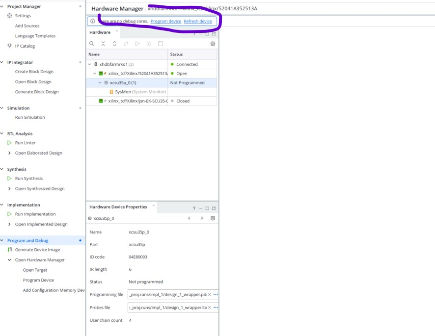

### Observe AXI Transactions with ILA

After programming, use the VIO and ILA dashboards in the Hardware Manager.

1. In the **VIO dashboard**, wait until `init_done` becomes 1 and then  set `probe_out0` = 1 to start ATG traffic.


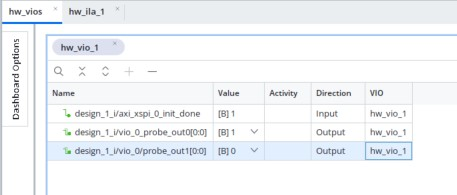

2. In the ILA trigger setup, set a trigger condition on `AWVALID` (rising edge).
3. Click **Run Trigger** (▶ button).

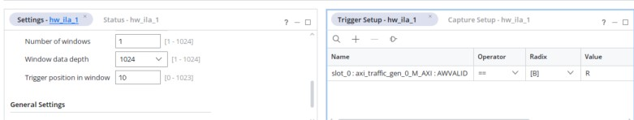


4. Observe the captured AXI transactions in the waveform viewer.
5.  **Write data**

  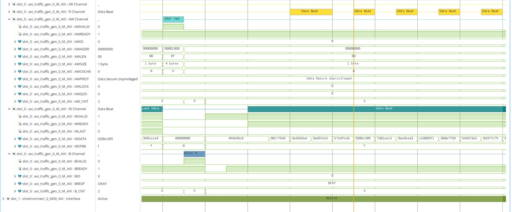
  
  
  **Read data**
  
  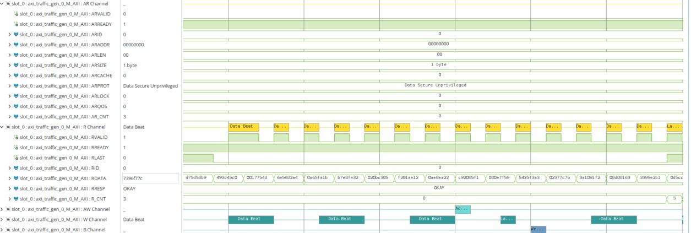

> **Note:** If `RRESP` or `BRESP` shows `10` (SLVERR), check the xSPI configuration — particularly the target latency and address mapping.

---

## References

- [AXI Traffic Generator Product Guide (PG381)](https://docs.amd.com/r/en-US/pg381-perf-axi-tg-spec)
- [AXI xSPI Product Guide (PG351)](https://docs.amd.com/r/en-US/pg351-axi-xspi)
- [SCU35 Board User Guide (UG1713)](https://docs.amd.com/r/en-US/ug1713-scu35-eval-bd/Introduction)
- [Vivado IP Integrator User Guide (UG994)](https://docs.amd.com/r/en-US/ug994-vivado-ip-subsystems)

<hr class="sphinxhide"></hr>

<p class="sphinxhide" align="center"><sub>Copyright © 2026 Advanced Micro Devices, Inc.</sub></p>

<p class="sphinxhide" align="center"><sub>Portions of this file consist of AI generated content.{}</sub></p>

<p class="sphinxhide" align="center"><sup><a href="https://www.amd.com/en/corporate/copyright">Terms and Conditions</a></sup></p>
