<table class="sphinxhide" width="100%">
 <tr width="100%">
    <td align="center"><h1>xSPI HyperRAM Design Tutorials</h1>
    <a href="https://www.amd.com/en/products/software/adaptive-socs-and-fpgas/vivado.html">See AMD Vivado™ Design Environment on amd.com</a>
    </td>
 </tr>
</table>

# Module 02: Running MicroBlaze from xSPI HyperRAM

***Version: Vivado 2026.1***

## Design Overview

This tutorial walks you through building an **xSPI HyperRAM™ memory controller** system on an AMD Spartan™ UltraScale+™ `xcsu35p-sbvb625-2-e` FPGA (SCU35 board) using Vivado 2026.1 IP Integrator. A **MicroBlaze™ RISC-V** soft processor runs from an external HyperRAM device via the **AXI xSPI IP**, with UART for serial debug output.

### System Architecture

```
                    ┌─────────────────────────────────────────────┐
  100MHz Diff ──►   │  Clocking Wizard (MMCM)                     │
  CLK_IN1_D         │  ├─ clk_out1: 200 MHz (system clock)        │
                    │  └─ clk_out2: 400 MHz (xSPI ext_spi_clk)    │
                    └─────────────────────────────────────────────┘
                                    │
                    ┌───────────────▼─────────────────────────────┐
                    │         MicroBlaze RISC-V                   │
                    │  (RV32IMFC, D/I-Cache, FPU, Debug)          │
                    └──┬──────────┬──────────────┬────────────────┘
                       │          │              │
                    M_AXI_DP   M_AXI_DC      M_AXI_IC
                    (periph)   (D-cache)     (I-cache)
                       │          │              │
                       ▼          ▼              ▼
              ┌────────────┐  ┌──────────────────────┐
              │SmartConnect│  │   SmartConnect (2SI) │
              │ (1SI/1MI)  │  │     (2SI/1MI)        │
              └─────┬──────┘  └──────────┬───────────┘
                    │                    │
                    ▼                    ▼
           ┌──────────────┐    ┌─────────────────┐
           │ AXI UARTLite │    │    AXI xSPI     │──► HyperRAM
           │  (115200bd)  │    │ (Octal DDR 200M)│    (External)
           └──────┬───────┘    └─────────────────┘
                  │
                  ▼
             UART TX/RX
```

### IP Cores Used

| IP Core | VLNV | Purpose |
|---------|------|---------|
| MicroBlaze RISC-V | `xilinx.com:ip:microblaze_riscv:1.0` | Soft processor (RV32IMFC with caches and FPU) |
| AXI xSPI | `xilinx.com:ip:axi_xspi:1.0` | xSPI/HyperRAM controller (Octal DDR, 200 MHz SCK) |
| AXI UARTLite | `xilinx.com:ip:axi_uartlite:2.0` | Serial debug interface (115200 baud) |
| Clocking Wizard | `xilinx.com:ip:clk_wiz:6.0` | Generates 200 MHz + 400 MHz from 100 MHz differential input |
| SmartConnect | `xilinx.com:ip:smartconnect:1.0` | AXI interconnect (x2 instances) |
| MDM RISC-V | `xilinx.com:ip:mdm_riscv:1.0` | MicroBlaze debug module |
| Proc Sys Reset | `xilinx.com:ip:proc_sys_reset:5.0` | Reset synchronizers (x2 instances) |
| LMB BRAM | `xilinx.com:ip:blk_mem_gen:8.4` | 128 KB local memory (True Dual Port) |
| LMB v10 | `xilinx.com:ip:lmb_v10:3.0` | Local memory bus (data + instruction) |
| LMB BRAM IF Cntlr | `xilinx.com:ip:lmb_bram_if_cntlr:4.0` | BRAM controller for LMB (data + instruction) |

### Memory Map

| Peripheral | Base Address | End Address | Range | Accessible From |
|-----------|-------------|-------------|-------|-----------------|
| LMB BRAM (dlmb_bram_if_cntlr) | 0x00000000 | 0x0001FFFF | 128 KB | Data bus |
| LMB BRAM (ilmb_bram_if_cntlr) | 0x00000000 | 0x0001FFFF | 128 KB | Instruction bus |
| AXI UARTLite | 0x40600000 | 0x4060FFFF | 64 KB | Data bus (via SmartConnect periph) |
| AXI xSPI (HyperRAM) | 0x80000000 | 0x807FFFFF | 8 MB | Data + Instruction bus (via SmartConnect periph1) |

---

## Prerequisites

- **AMD Vivado™ Design Suite 2026.1** (or compatible version) installed
- **Board files** for `xilinx.com:scu35:part0:2.0` installed in Vivado
- Basic familiarity with Vivado IP Integrator
- Target hardware: SCU35 evaluation board with HyperRAM attached

---

## Step 1: Create a New Vivado Project

1. **Launch Vivado 2026.1**
   - Open a terminal and run `vivado &`, or launch from the desktop shortcut

2. **Start the New Project Wizard:**
   - Menu bar: **File → Project → New** (or click "New Project" on the welcome screen)
   - The "New Project" wizard opens

3. **Set Project Name and Location:**
   - Project name: `project_1`
   - Project location: choose your working directory (e.g., `/home/user/fpga_designs/`)
   - ☑ Leave "Create project subdirectory" checked
   - Click **Next**

4. **Select Project Type:**
   - Choose: **RTL Project**
   - ☑ Select "Do not specify sources at this time" (we will add sources later via IPI)
   - Click **Next**

5. **Select the Target Board:**
   - At the top of the "Default Part" page, click the **Boards** tab (not "Parts")
   - In the search box, type `scu35`
   - Select: `Spartan UltraScale+ SCU35 Evaluation Platform`
   - This automatically maps to part: **xcsu35p-sbvb625-2-e**
   - Click **Next**

6. **Review and Finish:**
   - Verify the summary shows the correct board and project type
   - Click **Finish**
   - Vivado creates the project and opens the main IDE window

**Verification:** In the Project Summary you should see:
- Project part: `Spartan UltraScale+ SCU35 Evaluation Platform (xcsu35p-sbvb625-2-e)`

---

## Step 2: Create and Open the Block Design Canvas

1. **Open IP Integrator:**
   - In the **Flow Navigator** (left sidebar), find the "IP Integrator" section
   - Click **Create Block Design**

2. **Name the Design:**
   - A dialog appears asking for the design name
   - Design name: `design_1`
   - Directory: leave as default (`<Local to Project>`)
   - Click **OK**

3. **The IPI Canvas Opens:**
   - The center area switches to the "Diagram" tab showing an empty white canvas
   - The "Board" tab appears on the left (showing available board interfaces)
   - The "Design" tab shows the block design hierarchy (currently empty)

**Verification:** The Diagram tab header shows "design_1" and the canvas is empty with the message "This design is empty. Press the + button to add IP."

---

## Step 3: Add MicroBlaze RISC-V Processor

### 3A: Add the MicroBlaze RISC-V IP

1. **Add IP to canvas:**
   - Right-click on the empty canvas → select **Add IP** (or press `Ctrl+I`, or click the **+** button in the toolbar)
   - The "Search" dialog opens

2. **Find and instantiate MicroBlaze RISC-V:**
   - Type `MicroBlaze` in the search box
   - Double-click the result: **MicroBlaze V** (`xilinx.com:ip:microblaze_riscv:1.0`)
   - The IP block appears on the canvas as `microblaze_riscv_0`

### 3B: Run Block Automation

1. **Trigger Block Automation:**
   - A banner appears at the top of the Diagram area: "Run Block Automation"
   - Click on **Run Block Automation**

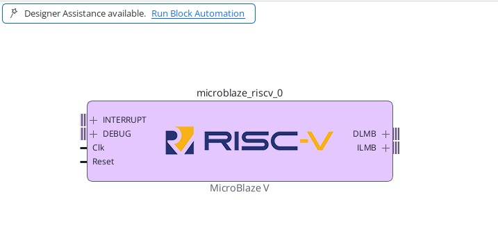

2. **Configure Block Automation Dialog:**
   - The dialog shows options for the MicroBlaze subsystem. Set these options (which should all be default):

   | Field | Value | Why |
   |-------|-------|-----|
   | Local Memory | **16KB** | Enough for bare-metal firmware + stack |
   | Cache Configuration | **None** | We will enable caches manually with custom settings |
   | Debug Module | **Debug Enabled** | Adds MDM for JTAG debug without trace |
   | Peripheral AXI Port | **Enabled** | Exposes M_AXI_DP for connecting peripherals |
   | Clock Connection | **New Clocking Wizard** | Auto-creates clk_wiz_1 with board clock input |

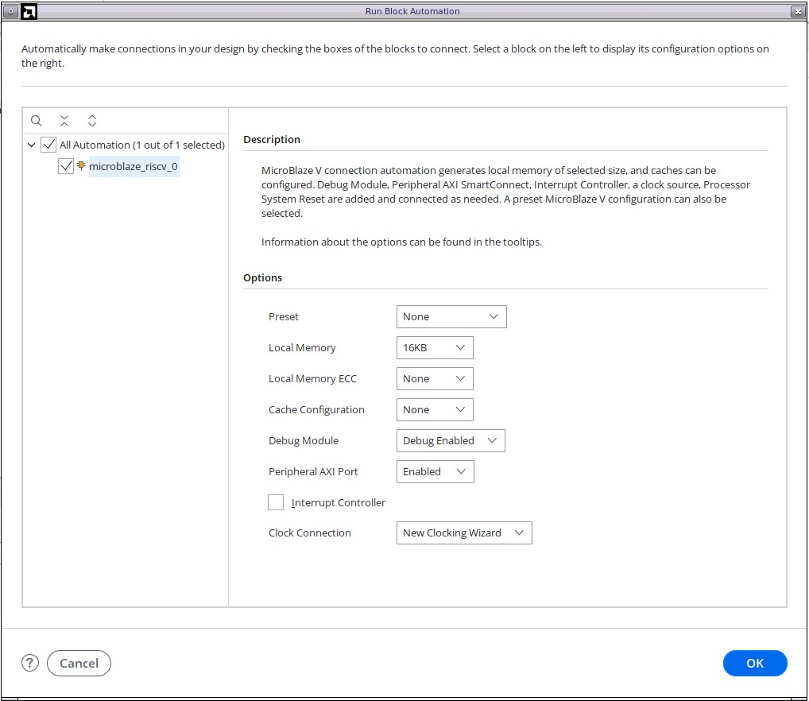

3. **Click OK** and wait for Vivado to generate the subsystem

4. **What Vivado creates automatically:**
   - `clk_wiz_1` — Clocking Wizard (connected to board differential clock)
   - `rst_clk_wiz_1_100M` — Processor System Reset (synchronized reset generation)
   - `mdm_1` — MicroBlaze Debug Module (RISC-V variant, JTAG interface)
   - `microblaze_riscv_0_local_memory` — Hierarchy containing:
     - `dlmb_v10` — Data Local Memory Bus
     - `ilmb_v10` — Instruction Local Memory Bus
     - `dlmb_bram_if_cntlr` — Data BRAM controller
     - `ilmb_bram_if_cntlr` — Instruction BRAM controller
     - `lmb_bram` — Block RAM (True Dual Port, shared between data and instruction)

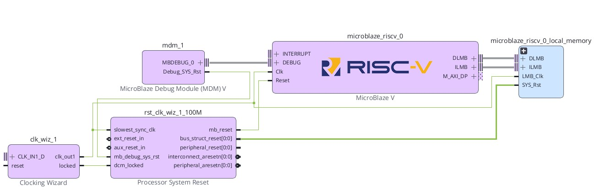

**Verification:** The canvas now shows MicroBlaze with LMB memory, clocking wizard, reset block, and debug module all connected.

### 3C: Customize MicroBlaze RISC-V Parameters

1. **Open Customization:**
   - Double-click the `microblaze_riscv_0` block on the canvas
   - The "Re-customize IP" dialog opens with multiple pages or tabs

2. **Set Each Parameter:**

   **Welcome page (1):**
   | Parameter | Value | Explanation |
   |-----------|-------|-------------|
   | Select Configuration | **Real-time (RV32IMAC)** | Pre-selects a balanced configuration |
   | Select implementation optimization | **AREA** | Minimize resource usage |
   | Enable Instruction Cache | **✓ (Enabled)** | Instruction cache for XIP from HyperRAM | -->
   | Enable Data Cache | **✓ (Enabled)** | Data cache for AXI memory accesses | -->

   **General page (2):**
   | Parameter | Value | Explanation |
   |-----------|-------|-------------|
   | Enable Atomic Instructions | **✓ (Enabled)** | Support atomic memory operations (RV32A) |
   | Enable Integer Multiply and Divide | **OPTIMIZED** | Pipelined hardware multiplier/divider (RV32M) |
   | Enable Floating Point Unit | **SINGLE** | Single-precision floating point (RV32F) |
   | Enable Code Compression | **✓ (Enabled)** | Support RV32C compressed instructions (smaller code) |
   | Select Barrel Shifter Implementation | **PERFORMANCE** | Pipelined barrel shifter for fast shifts |
   | Enable Branch Target Cache | **0 (Disabled)** | Save resources; BTC not needed at this frequency |
   <!-- Does Mult&Div Optimized map to Two-stage? Does Barrel Shifter Performance map to Two-stage? -->

   **Exception page (3):**
   | Parameter | Value | Explanation |
   |-----------|-------|-------------|
   | Enable Illegal Instruction Exception | **BASIC** | Trap on invalid opcodes |
   <!-- this has options of NONE|BASIC|COMPLETE not Yes|No -->

   **Cache page (4):**
   | Parameter | Value | Explanation |
   |-----------|-------|-------------|
   | Instrucution Cache Size in Bytes | **64B** | 64-byte I-cache |
   | Instruction Cache Line Length | **4** | 4-word (16-byte) cache lines |
   | Data Cache Size in Bytes | **64B** | 64-byte D-cache (minimal, for HyperRAM bursting) |

   **Debug page (5):**
   | Parameter | Value | Explanation |
   |-----------|-------|-------------|
   | Debug Module Interface | **✓ (Enabled)** | Enable debug interface to MDM |
   | Number of PC Breakpoints | **2** | 2 hardware PC breakpoints |
   | Number of Write Address Watchpoints | **1** | 1 read address watchpoint |
   | Number of Read Address Watchpoints | **1** | 1 write address watchpoint |

   **Buses page (6):**
   | Parameter | Value | Explanation |
   |-----------|-------|-------------|
   | C_D_AXI??? | **1 (Enabled)** | Exposes M_AXI_DC port for data cache fills |
   | C_I_AXI??? | **0 (Disabled)** | I-cache shares the DC path through SmartConnect |
   <!-- No idea what these two options map to. -->


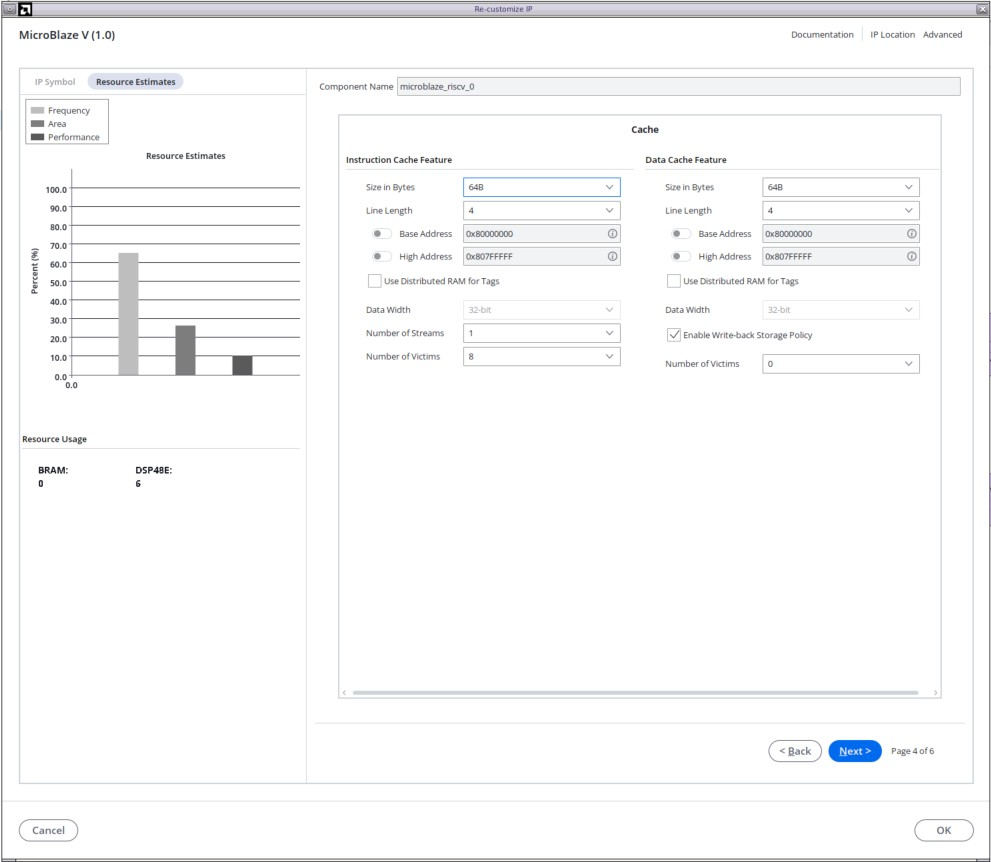

3. **Click OK** to apply all changes

**Verification:** The MicroBlaze block on the canvas now shows additional ports: `M_AXI_DC` (data cache AXI master) and `M_AXI_IC` (instruction cache AXI master) alongside the existing `M_AXI_DP`.

---

## Step 4: Configure the Clocking Wizard

1. **Open Clocking Wizard Customization:**
   - Double-click `clk_wiz_1` on the canvas
   - The customization dialog opens

2. **Board Tab:**

   | Field | Value | Notes |
   |-------|-------|-------|
   | CLK_IN1 | **sys_diff_clock** | Auto-connects to board clock pins |
   | EXT_RESET_IN | **reset** | Auto-connects to board reset button |

3. **Clocking Options Tab:**

   | Field | Value | Notes |
   |-------|-------|-------|
   | Primitive | **MMCM** | Mixed-Mode Clock Manager (more flexible than PLL) |
   | Input Frequency (clk_in1) | **100.000 MHz** | Board oscillator frequency |

4. **Output Clocks Tab:**

   | Output | Enabled | Requested Frequency | Actual (computed) | Purpose |
   |--------|---------|---------------------|-------------------|---------|
   | clk_out1 | **✓** | **200.000 MHz** | 200.000 MHz | System clock for MicroBlaze, AXI buses, peripherals |
   | clk_out2 | **✓** | **400.000 MHz** | 400.000 MHz | xSPI external SPI clock (divided by 2 → 200 MHz SCK) |
   | Reset Type | **Active Low** | Board reset button is active-low |

5. **MMCM Settings Tab:**

Verify computed MMCM parameters (shown in read-only fields):
   - CLKFBOUT_MULT_F = **12.000** (VCO = 100 × 12 = 1200 MHz)
   - CLKOUT0 Divide = **6.000** (1200 / 6 = 200 MHz)
   - CLKOUT1 Divide = **3** (1200 / 3 = 400 MHz)

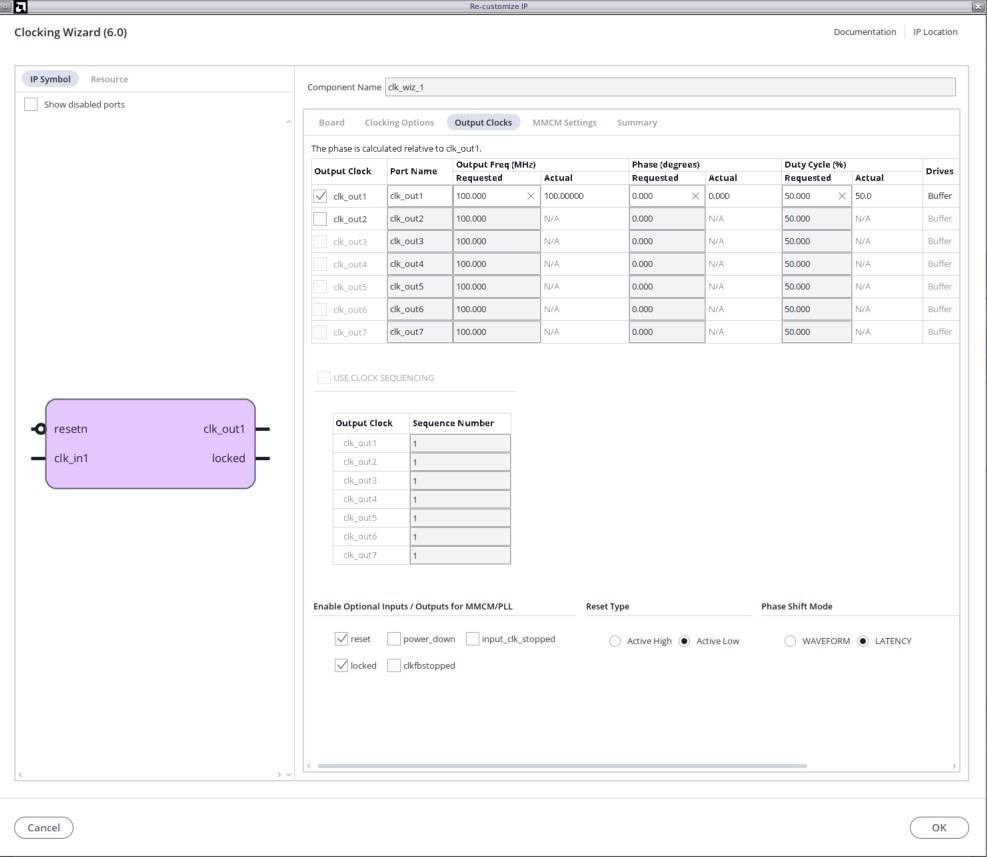

5. **Click OK**

**Verification:** The `clk_wiz_1` block now shows ports `clk_out1`, `clk_out2`, `CLK_IN1_D`, `resetn`, and `locked`.

---

## Step 5: Add and Configure the AXI xSPI IP (HyperRAM Controller)

### 5A: Add the IP

1. Right-click canvas → **Add IP** (or `Ctrl+I`)
2. Search for `AXI xSPI`
3. Double-click **AXI xSPI** (`xilinx.com:ip:axi_xspi:1.0`) to instantiate
4. The block `axi_xspi_0` appears on the canvas

### 5B: Configure xSPI Parameters

1. Double-click `axi_xspi_0` to open customization
2. Set the following parameters:

   | Parameter | Value | Explanation |
   |-----------|-------|-------------|
   | Enable Performance Mode | **✓ (Enabled)** | Enable XIP performance mode (allows execute-in-place from HyperRAM) |
   | Enable AXI Lite | **0 (Disabled)** | Use **full AXI4** slave interface (supports bursts, required for cache fills) |
   | External SPI Clock Frequency(MHz) | **Enabled, 400** | External SPI clock input frequency = 400 MHz (from clk_wiz_1/clk_out2) |
   | Frequency Ratio | **2** | SCK output = ext_spi_clk ÷ 2 = 200 MHz (max HyperRAM clock) |
   | Enable HWRESET | **✓ (Enabled)** | Enable hardware reset output pin to HyperRAM chip |
   | TXFIFO and RXFIFO Depth | **256** | TX/RX FIFO depth of 256 entries (maximizes burst efficiency) |
   | Latency (clock cycles) | **7** | HyperRAM target latency = 7 cycles (typical for 200 MHz operation) |
   
   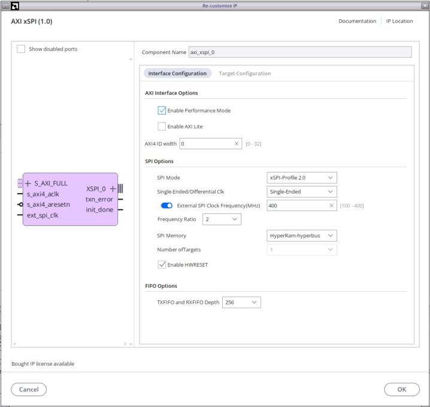

3. **Click OK**

**Verification:** The `axi_xspi_0` block shows these ports:
- `S_AXI_FULL` — AXI4 slave (connects to SmartConnect)
- `s_axi4_aclk` — AXI clock input (200 MHz)
- `s_axi4_aresetn` — AXI reset input (active-low)
- `ext_spi_clk` — 400 MHz clock input
- `XSPI_0` — xSPI memory interface bus (goes to external HyperRAM pins)
- `txn_error` — 
- `init_done` — 

### 5C: Connect xSPI with MicroBlaze

 1. Right-click canvas → **Add IP** (or `Ctrl+I`), search of `AXI SmartConnect` and instantiate it.
 2. Double-click to configure:

   | Parameter | Value | Explanation |
   |-----------|-------|-------------|
   | Number of Slave Interfaces | **2** | M_AXI_DC (S00) + M_AXI_IC (S01) |
   | Number of Master Interfaces | **1** | Only xSPI downstream |
   | Number of Clock Inputs | **1** | Single clock domain (200 MHz) |

 3. Connect the MicroBlaze and xSPI as shown in image below
   
 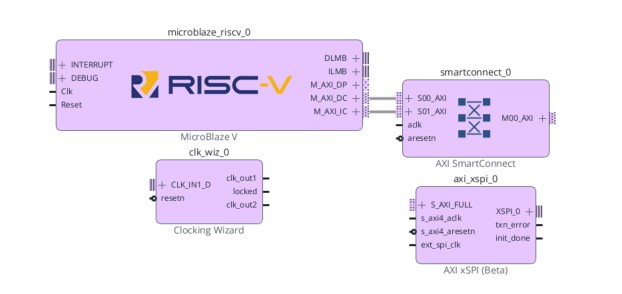
 
---

## Step 6: Add and Configure the AXI UARTLite IP

### 6A: Add the IP

1. Right-click canvas → **Add IP** → search `AXI UARTLite`
2. Double-click **AXI Uartlite** (`xilinx.com:ip:axi_uartlite:2.0`) to instantiate
3. The block `axi_uartlite_0` appears

### 6B: Configure UARTLite Parameters

1. Double-click `axi_uartlite_0`
2. Set:

   | Parameter | Value | Explanation |
   |-----------|-------|-------------|
   | uart Board Interface | **scu35_uartb** | Auto-connects TX/RX to the correct board UART header pins |
   | Baud Rate | **115200** | Standard baud rate for serial terminals |

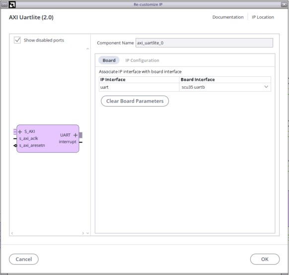

3. **Click OK**


**Verification:** The `axi_uartlite_0` block shows ports `S_AXI`, `s_axi_aclk`, `s_axi_aresetn`, `UART` (TX/RX interface) and `interrupt`.

---

## Step 7: Connection Automation 

1. Click on the `Run Connection Automation` link
2. select All Automation check box and click `OK`

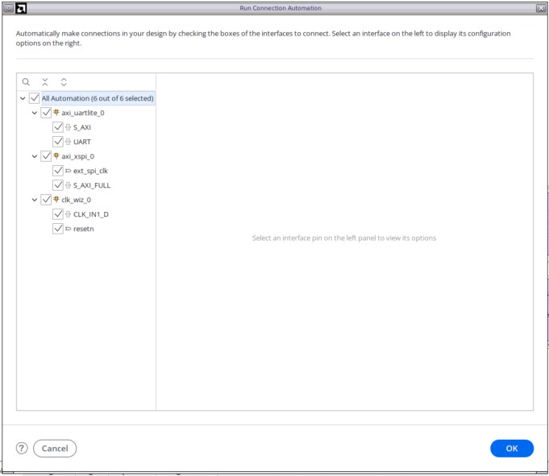

3. It will add other necessary IPs and makes all the connections. The final block design should match the image below. 

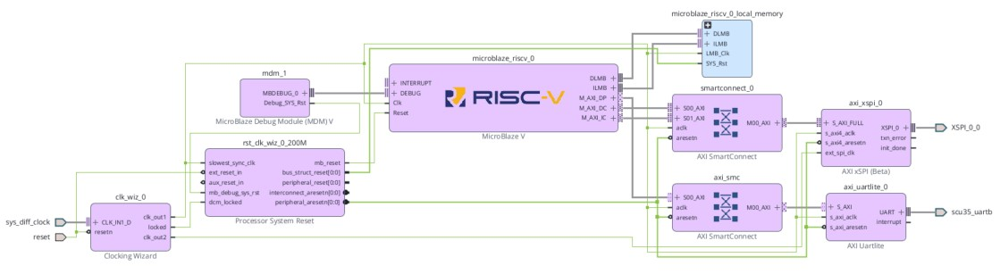


## Step 8: Assign Addresses in the Address Editor

1. **Open the Address Editor:**
   - Click the **Address Editor** tab (at the top of the IPI canvas area, next to "Diagram")
   - If not visible, go to **Window → Address Editor**

2. **Assign/Verify Each Address:**

   You may need to right-click unmapped segments and select **Assign Address**. Then edit the offset and range:

   | Master | Address Space | Slave Segment | Offset Address | Range |
   |--------|---------------|---------------|----------------|-------|
   | microblaze_riscv_0 | **Data** | dlmb_bram_if_cntlr / Mem | `0x00000000` | 16k |
   | microblaze_riscv_0 | **Data** | axi_uartlite_0 / Reg | `0x40600000` | 64K |
   | microblaze_riscv_0 | **Data** | axi_xspi_0 / Mem | `0x80000000` | 8M |
   | microblaze_riscv_0 | **Instruction** | ilmb_bram_if_cntlr / Mem | `0x00000000` | 16k |
   | microblaze_riscv_0 | **Instruction** | axi_xspi_0 / Mem | `0x80000000` | 8M |


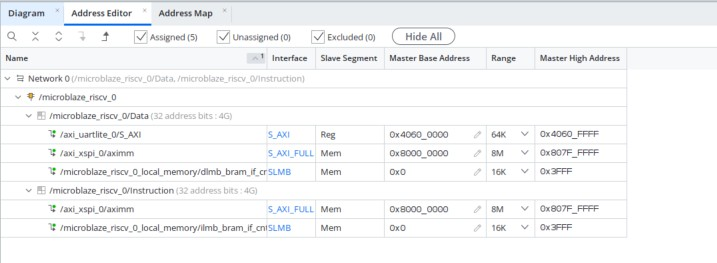

   > **Important:** The xSPI is mapped in both Data and Instruction spaces. This allows Execute-In-Place (XIP) — the I-cache can fetch instructions directly from HyperRAM.

---

## Step 9: Validate the Block Design

**Goal:** Run Design Rule Checks (DRC) to ensure all connections and configurations are valid.

1. **Validate:**
   - Click the **Validate Design** button (✓ checkmark icon in the IPI toolbar)
   - Or press **F6**
   - Or menu: **Tools → Validate Design**

2. **Expected Result:**
   - A green dialog: *"Validation successful. There are no errors or critical warnings in this design."*
   - Click **OK**

3. **Save the design:** Press `Ctrl+S`

---

## Step 10: Create the HDL Wrapper


1. **In the Sources panel** (usually bottom-left of Vivado):
   - Expand **Design Sources**
   - Find `design_1` (design_1.bd) — it should have a BD icon

2. **Create Wrapper:**
   - Right-click `design_1.bd` → select **Create HDL Wrapper**
   - A dialog asks how to manage the wrapper:
     - Select: *"Let Vivado manage wrapper and auto-update"*
   - Click **OK**

3. **Result:**
   - Vivado generates `design_1_wrapper.v` (Verilog)
   - This file becomes the new **top module** of the project
   - It appears in Sources as the hierarchy root

**Verification:** In the Sources panel, `design_1_wrapper` is shown as the top module (bold, with a hierarchy icon). The file is at: `project_1.gen/sources_1/bd/design_1/hdl/design_1_wrapper.v`

---

## Step 11: Add XDC Pin Constraints

### 11A: Create the Constraints File

1. In the Flow Navigator → click **Add Sources** (or menu: File → Add Sources)
2. Select **Add or create constraints** → Click **Next**
3. Click **Create File**:
   - File name: `xspi_constraints`
   - File type: **XDC**
   - Click **OK**
4. Click **Finish**

### 11B: Add Pin Assignments

1. In the Sources panel, expand **Constraints → constrs_1**
2. Double-click `xspi_constraints.xdc` to open it in the editor
3. Paste the following complete constraint file:

```tcl
# ============================================================
# xSPI HyperRAM Pin Assignments for SCU35 Board
# Target: xcsu35p-sbvb625-2-e
# ============================================================

# --- Chip Select (active-low, directly driven by xSPI IP) ---
set_property PACKAGE_PIN B23 [get_ports {XSPI_0_0_cs[0]}]
set_property IOSTANDARD LVCMOS18 [get_ports {XSPI_0_0_cs[0]}]

# --- Data Strobe (DS) - bidirectional, used for DDR data alignment ---
set_property PACKAGE_PIN C22 [get_ports XSPI_0_0_ds]
set_property IOSTANDARD LVCMOS18 [get_ports XSPI_0_0_ds]

# --- Data IO[0:7] - Octal data bus (bidirectional) ---
set_property PACKAGE_PIN C20 [get_ports XSPI_0_0_io0]
set_property IOSTANDARD LVCMOS18 [get_ports XSPI_0_0_io0]

set_property PACKAGE_PIN B20 [get_ports XSPI_0_0_io1]
set_property IOSTANDARD LVCMOS18 [get_ports XSPI_0_0_io1]

set_property PACKAGE_PIN A23 [get_ports XSPI_0_0_io2]
set_property IOSTANDARD LVCMOS18 [get_ports XSPI_0_0_io2]

set_property PACKAGE_PIN A24 [get_ports XSPI_0_0_io3]
set_property IOSTANDARD LVCMOS18 [get_ports XSPI_0_0_io3]

set_property PACKAGE_PIN A20 [get_ports XSPI_0_0_io4]
set_property IOSTANDARD LVCMOS18 [get_ports XSPI_0_0_io4]

set_property PACKAGE_PIN A21 [get_ports XSPI_0_0_io5]
set_property IOSTANDARD LVCMOS18 [get_ports XSPI_0_0_io5]

set_property PACKAGE_PIN B21 [get_ports XSPI_0_0_io6]
set_property IOSTANDARD LVCMOS18 [get_ports XSPI_0_0_io6]

set_property PACKAGE_PIN B22 [get_ports XSPI_0_0_io7]
set_property IOSTANDARD LVCMOS18 [get_ports XSPI_0_0_io7]

# --- Hardware Reset to HyperRAM (active-low) ---
set_property PACKAGE_PIN E21 [get_ports XSPI_0_0_resetn]
set_property IOSTANDARD LVCMOS18 [get_ports XSPI_0_0_resetn]

# --- Serial Clock (SCK) - single-ended output to HyperRAM ---
set_property PACKAGE_PIN B24 [get_ports XSPI_0_0_sck_p]
set_property IOSTANDARD LVCMOS18 [get_ports XSPI_0_0_sck_p]

# ============================================================
# Drive Strength - 12 mA for signal integrity at 200 MHz
# ============================================================
set_property DRIVE 12 [get_ports {XSPI_0_0_ds XSPI_0_0_sck_p XSPI_0_0_resetn XSPI_0_0_io6 XSPI_0_0_io5 XSPI_0_0_io4 XSPI_0_0_io2}]

# ============================================================
# Fast Slew Rate - required for DDR signaling at 200 MHz
# ============================================================
set_property SLEW FAST [get_ports {XSPI_0_0_ds XSPI_0_0_io0 XSPI_0_0_io1 XSPI_0_0_io2 XSPI_0_0_io3 XSPI_0_0_io4 XSPI_0_0_io5 XSPI_0_0_io6 XSPI_0_0_io7}]

# ============================================================
# Timing Constraints
# The xSPI IP handles data recovery internally using the DS
# strobe. All xSPI I/O pins are asynchronous to the FPGA
# fabric clock from a timing analysis perspective.
# ============================================================
set_false_path -from [get_ports XSPI_0_0_ds]
set_false_path -from [get_ports XSPI_0_0_io*]
set_false_path -to [get_ports XSPI_0_0_ds]
set_false_path -to [get_ports XSPI_0_0_io*]

# ============================================================
# DDR Data Rate Declaration
# Informs Vivado that these pins toggle at double-data-rate
# ============================================================
set_property DATA_RATE DDR [get_ports XSPI_0_0_ds]
set_property DATA_RATE DDR [get_ports XSPI_0_0_io*]
```

4. **Save** the file: `Ctrl+S`

### 11C: Understanding the Constraints

| Constraint | Purpose |
|-----------|---------|
| `PACKAGE_PIN` | Maps each HDL port to a specific FPGA ball/pin on the BGA package |
| `IOSTANDARD LVCMOS18` | Sets 1.8V I/O voltage (HyperRAM operates at 1.8V) |
| `DRIVE 12` | 12 mA output drive strength for clean signal edges |
| `SLEW FAST` | Fast slew rate to support 200 MHz DDR transitions |
| `set_false_path` | Tells timing analysis to ignore these paths (xSPI IP has internal source-synchronous capture) |
| `DATA_RATE DDR` | Declares these are DDR signals (Vivado uses this for I/O planning) |

---

## Step 12: Run Synthesis


1. In the **Flow Navigator** (left panel), under "SYNTHESIS":
   - Click **Run Synthesis**

2. **Launch Runs Dialog:**
   - Number of jobs: select based on your machine (e.g., 4–8)
   - Click **OK**

3. **Wait for Synthesis to Complete:**
   - The status bar at the top-right shows progress
   - A green checkmark appears next to "Run Synthesis" when done
   - Typical time: 2–10 minutes depending on machine

4. **When prompted "Synthesis Completed":**
   - Select **Open Synthesized Design** to inspect results (optional)
   - Or select **Run Implementation** to continue

5. **Check for Errors:**
   - Open the **Messages** tab (bottom panel)
   - Look for any **ERROR** messages (red)
   - Warnings (yellow) about unconnected pins are usually acceptable
   - Critical Warnings about timing should be investigated

---

## Step 13: Run Implementation (Place & Route)

**Goal:** Place and route the synthesized netlist onto the physical FPGA fabric.

1. In the Flow Navigator, under "IMPLEMENTATION":
   - Click **Run Implementation**

2. **Launch Runs Dialog:**
   - Click **OK** (use default settings)

3. **Wait for Implementation to Complete:**
   - This takes longer than synthesis (5–20 minutes)
   - Green checkmark appears when done

4. **When prompted "Implementation Completed":**
   - Select **Open Implemented Design** to check timing (recommended)
   - Or select **Generate Bitstream** to continue

5. **Check Timing (Important!):**
   - If you opened the implemented design, look at the **Timing Summary**
   - In the Tcl Console, run: `report_timing_summary`
   - Verify: **WNS (Worst Negative Slack) ≥ 0** for all clock domains
   - If WNS < 0, you have timing violations that need to be fixed before generating the bitstream

---

## Step 14: Generate the Device Image and Export Hardware.
### 14A
1. In the Flow Navigator, under "PROGRAM AND DEBUG":
   - Click **Generate Device Image**

2. **Launch Runs Dialog:**
   - Click **OK**

3. **Wait for Device Image Generation:**
   - Typically 1–5 minutes
   - Green checkmark appears when done

4. **When prompted "device Image Generation Completed":**
   - Select **Open Hardware Manager** if you want to program immediately
   - Or select **View Reports** to review results

5. **Bitstream Location:**
   ```
   project_1/project_1.runs/impl_1/design_1_wrapper.pda
   ```
---

### 14B

1. Menu bar: **File → Export → Export Hardware**

2. **Launch Export Hardware Platform Dialog:**
3. select `include device image' and click `Next`
4. provide XSA file name and export path then click `Next` then `Finish`

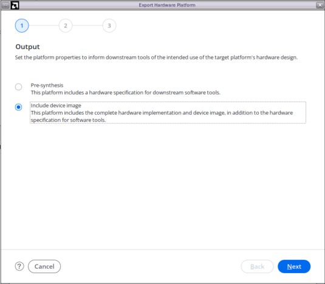


## Step 15: Vitis IDE

### 15AA: Create vitis Platform project
1. launch the Vitis IDE 
    Menu bar: **Tools → Launch Vitis IDE**
2. Create platform in Vitis IDE     
    Menu bar: **File → New Component → Platform**
3. Provide the platform component name and component location then click `Next`
 
 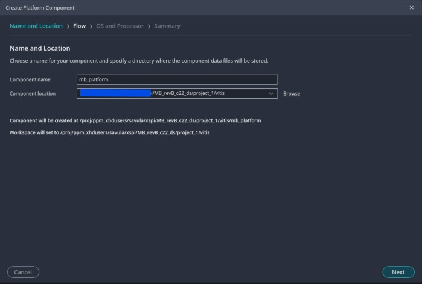
 
4. Select `Hardware Design` for flatform creation flow and `Browse` the `XSA file` exported from Vivado. then click `Next`

 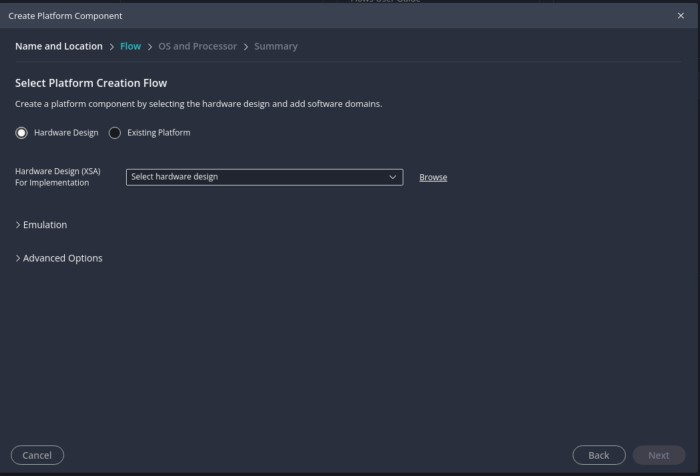
 
5. Select OS and Processor, click `Next' and then `Finish`.
 
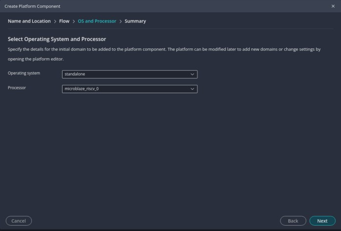

6. Build the component 


### 15B: Create Helloworld application

1. Click on the Examples and select Hello World application then `create component from Template`
 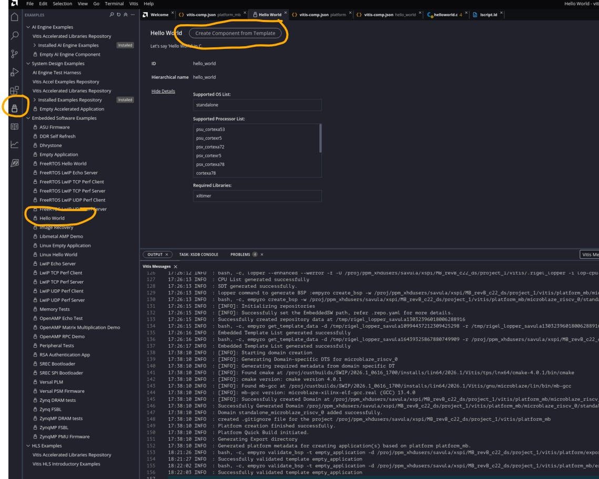
     
2. Provide the application component name and component location then click `Next`
 
 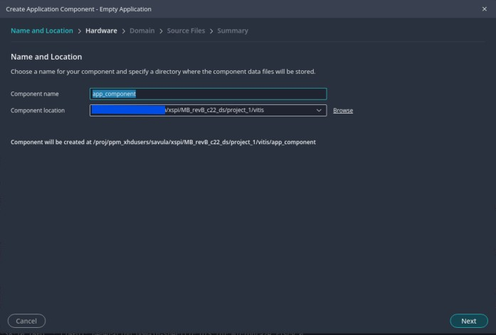
 
3. Select the platform create in previous step, click on `Next` then `Finish`
   
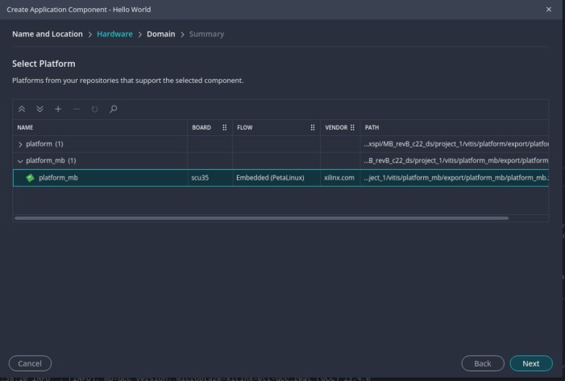

4. Once Hello World application created, open the ld (linker script) file to map every section to Hyper RAM memory as shown below. 
 
 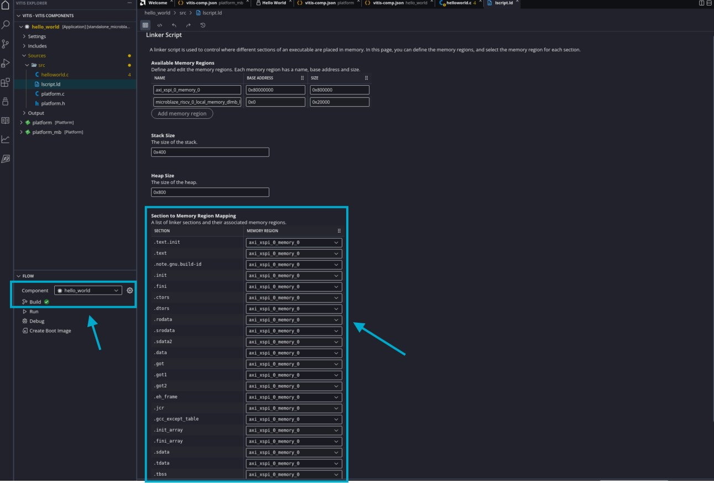
  
5.Open BSP settings and check if standalone stdin and stdout are set correct UART (axi_uartlite_0).

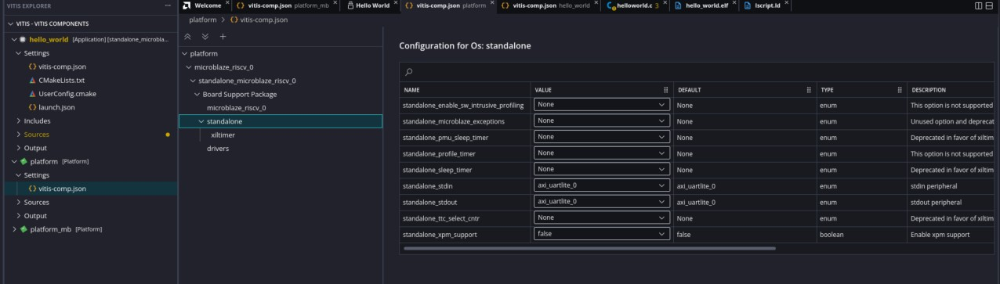

6.  Build the Application component.


## Step 17: Program the FPGA

   Open the UART console and connect it to hardware. This verifies the MicroBlaze UART output.

### Program the FPGA

1. Connect the SCU35 board to the host via JTAG/USB.
2. In the Vivado Flow Navigator, click **Open Hardware Manager → Open Target → Auto Connect**.
3. Right-click the detected device → **Program Device**.
4. Browse to the `.PDI` file and click **Program**.
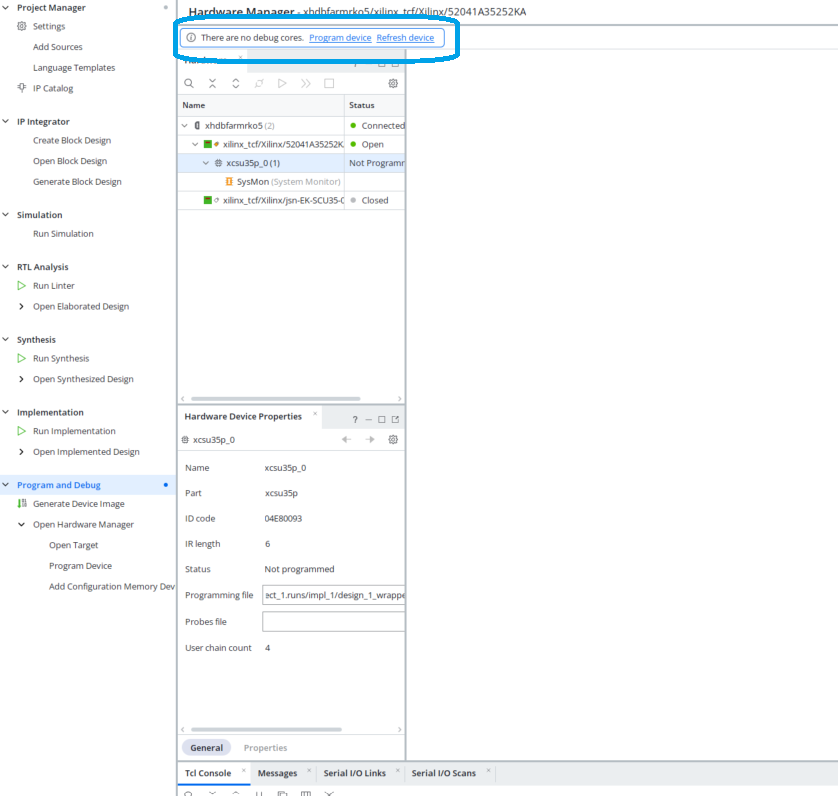

### Run the MicroBlaze Application

1. Launch XSDB from Vitis.
    Menu bar: **Vitis → XSDB Console**
2. Connect to the hardware. If the hardware is local to the host machine, use the `connect` command. If the hardware is remote, use the following:

 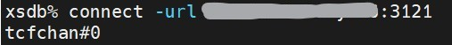
 
3. Launch the MicroBlaze application on hardware.

 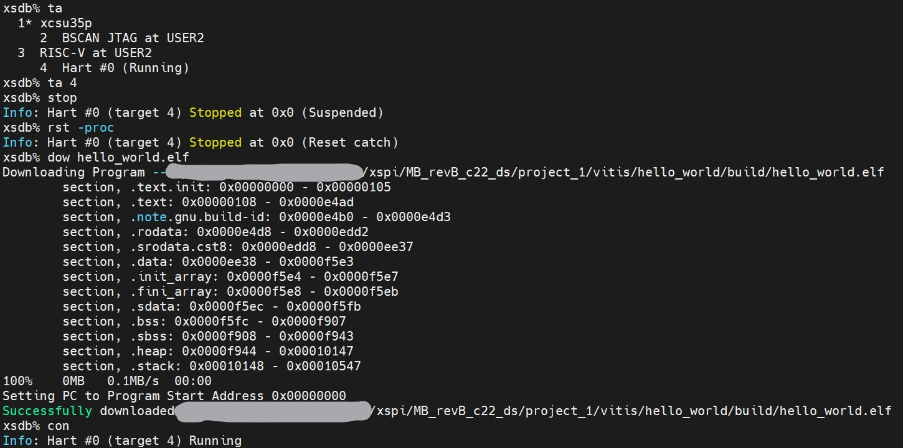
      
4. Open the UART Console and check the output

 
 

## Troubleshooting

| Issue | Solution |
|-------|----------|
| Block automation doesn't appear | Ensure MicroBlaze is the only unconnected IP; delete and re-add if needed |
| "No valid clock" error in validation | Verify clk_wiz_1/clk_out1 is connected to all aclk ports |
| Address editor shows unmapped segments | Right-click each unmapped entry → Assign Address → set offset manually |

---

<hr class="sphinxhide"></hr>

<p class="sphinxhide" align="center"><sub>Copyright © 2026 Advanced Micro Devices, Inc.</sub></p>

<p class="sphinxhide" align="center"><sub>Portions of this file consist of AI generated content.{}</sub></p>

<p class="sphinxhide" align="center"><sup><a href="https://www.amd.com/en/corporate/copyright">Terms and Conditions</a></sup></p>

