<table class="sphinxhide" width="100%">
 <tr width="100%">
    <td align="center"><h1>Versal™ NoC2 and DDRMC5 Design Tutorials</h1>
    <a href="https://www.amd.com/en/products/software/adaptive-socs-and-fpgas/vivado.html">See Vivado™ Development Environment on amd.com</a>
    </td>
 </tr>
</table>

# Inline ECC and Crypto with NoC2 and DDRMC5

***Version: Vivado 2025.2***

This tutorial demonstrates the generation of a design with Inline ECC (ILECC), and Crypto (AES-GCM, XTS-AES-256) features enabled. You will learn about ILECC and
Crypto configuration in an LPDDR5X memory controller design with AXI Performance traffic generators using the Advanced Configuration Editor. You will download
an implemented design PDI to the VEK385 board. You will observe hardware performance differences between a memory controller without ILECC or Crypto enabled and
memory controllers with either ILECC or Crypto enabled.  

## Description of the Design

This design has four 1x32 LPDDR5X memory controllers, each with two AXI performance traffic generators:
1. DDRMC1 (axi_noc2_1) – has neither ILECC nor crypto enabled
2. DDRMC2 (axi_noc2_2) – has ILECC enabled
3. DDRMC3 (axi_noc2_3) – has XTS-AES-256 enabled
4. DDRMC4 (axi_noc2_4) – has AES-GCM enabled

To switch on the ILECC or Crypto features, they need to be enabled in the NoC IP’s memory controller., and later configured using the Advanced Configuration Editor (ACE).

This tutorial will focus on:
1.	Creating a design & hardware handoff (XSA) file with ILECC & Crypto enabled in Vivado
2. Configuring ILECC & Crypto in ACE

Pre-built PDIs and an XSA for this design are provided. To build the design yourself, open Vivado and run the following:

```tcl
cd ./design
source ./design_1.tcl
```

This script will instantiate and connect all required IP, including four axi_noc2 instances with memory controllers enabled, traffic generators, the
processing system, clocking, etc. The completed design should appear as follows:
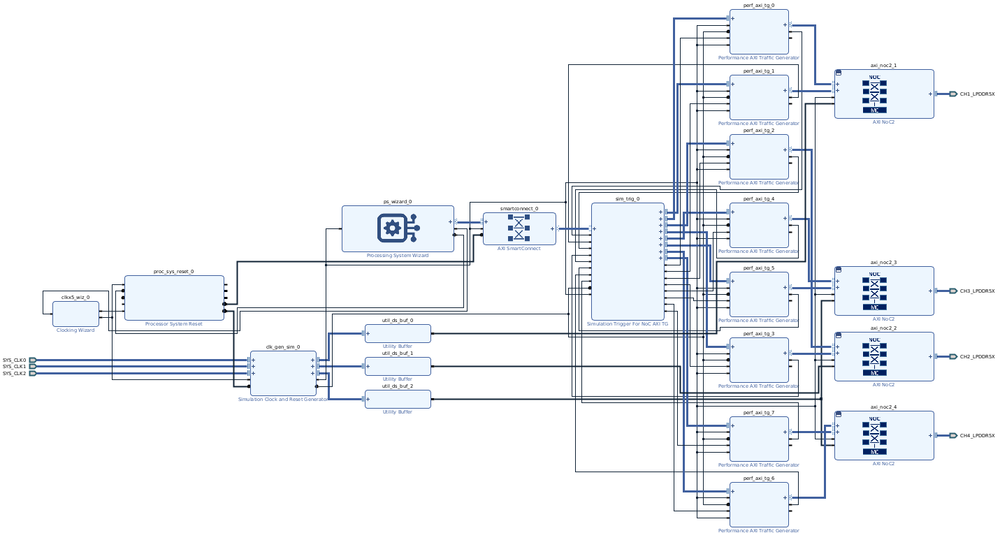

## Steps for PDI and XSA Generation

1. Note that designs requiring ILECC, XTS, or GCM configuration in the Advanced Configuration Editor must have them enabled in the NoC IP. The block design for this lab (design_1.tcl) has either ILECC, XTS, or GCM enabled in the AXI NoC2 GUI for three of the four DDRMCs as shown below:
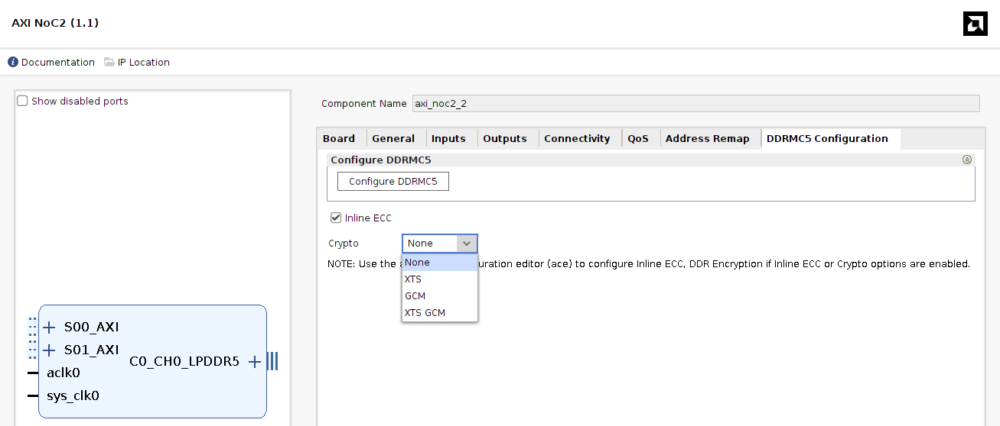

2. Under Design Sources, right click on design_1 -> Create HDL Wrapper -> Let Vivado manage wrapper and auto-update -> OK
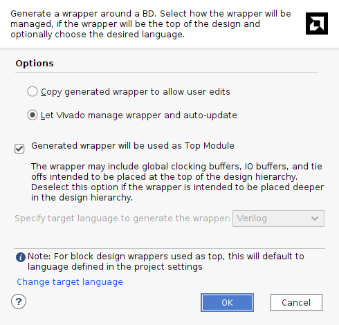

3. Click on the Sources tab, under Design Sources, right click on Constraints, and select Add Sources.  Select ‘Add or create constraints’ and click Next. Click on Add Files. In the Add Constraint Files GUI navigate select the VEK385_pinout_internal_clock.xdc file and click OK.
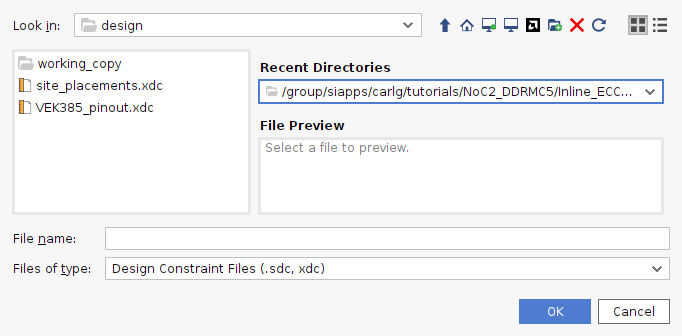

4. Click Finish

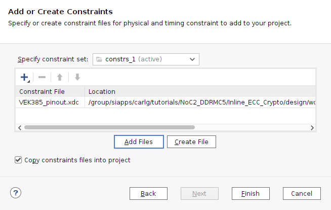

5. Save the project and Generate Device Image
6. Generate an XSA:
    1. Open Implemented Design
    2. Select File->Export->Export Hardware
    3. Click Next and select Include Device Image as shown in the figure below.  Keep clicking Next until you can click Finish.
    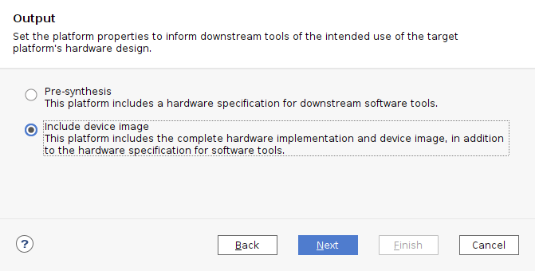
    4. An XSA is generated in the project directory.

## Launching the Advanced Configuration Editor

1. In your terminal window, change to the design directory
```csh
cd ./design/myproj
```
2. Launch the Advanced Configuration Editor, having it read in the .xsa file
```csh
ace --xsa design_1_wrapper.xsa --gui
```
3. You can get command line help using -h or --help
```csh
ace -h
```

The  Advanced Configuration Editor launches in a browser as shown in the following screenshot. You will see 3 expected errors associated with axi_noc2_2/ddrmc, axi_noc2_3/ddrmc, and axi_noc2_4/ddrmc. These are the memory controllers with ILECC, XTS-AES-256, and AES-GCM enabled respectively.

These errors are expected when either Inline ECC (ILECC) or Crypto (XTS-AES-256, AES-GCM) is enabled in Vivado. The Advanced Configuration Editor does not automatically configure them because the user needs to choose what memory regions use ILECC or encryption.
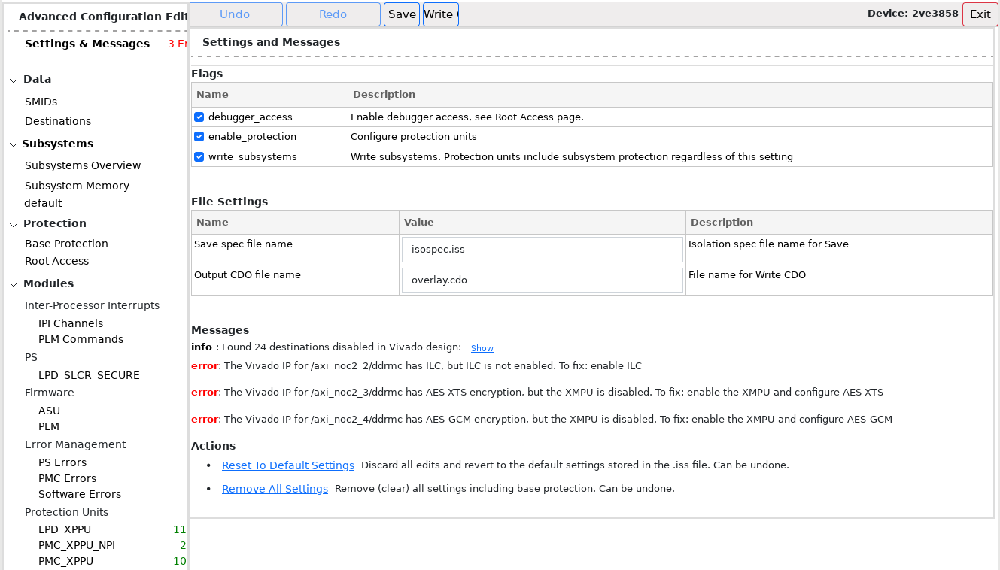

## Configuring Inline ECC for /axi_noc2_2/ddrmc

Scroll to the bottom on the left panel and click on /axi_noc2_2/ddrmc, and then click on the Inline ECC checkbox as shown below. You have configured this memory controller for inline ECC, and this should reduce the number of errors from 3 to 2. In this example, Inline ECC is enabled for the maximum protected memory size of 3640 M as shown in the figure below.
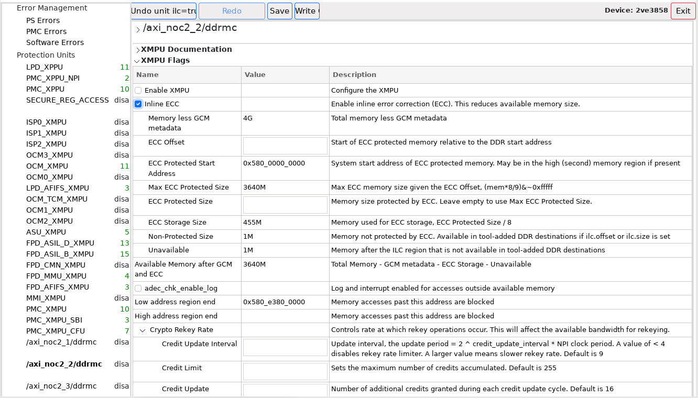

## Description of Configuration Options for Inline ECC

**Memory less GCM metadata:** Since AES-GCM is not enabled in this memory controller, the total available DRAM memory is 4GB (4096MB)

**ECC Offset:** Enter a value if DDR start address is different from ECC Protected Start Address

**Max ECC Protected Size:** (Memory less GCM metadata x 8)/9) = (4096MB x 8)/9 = 3640MB

**ECC Protected Size:** Leave it empty to maximize the protected memory or set it to Max ECC Protected Size

**ECC Storage Size:** ECC is stored in DRAM memory in an interleaved fashion. ECC storage requires (ECC Protected Size)/8 = 3640MB/8 = 455MB

**Non-Protected Size:** (Memory less GCM metadata – (Max ECC Protected Size + ECC Storage Size)) = (4096 – (3640 + 455)) = 1MB

**Low address region end:** 0x580_e380_0000 – Memory accesses past the 3640MB of ECC protected memory size are blocked.

## Configuring XTS-AES-256 for /axi_noc2_3/ddrmc

Scroll to the bottom on the left panel, click on /axi_noc2_3/ddrmc, and then click on the Enable XMPU checkbox as shown below.
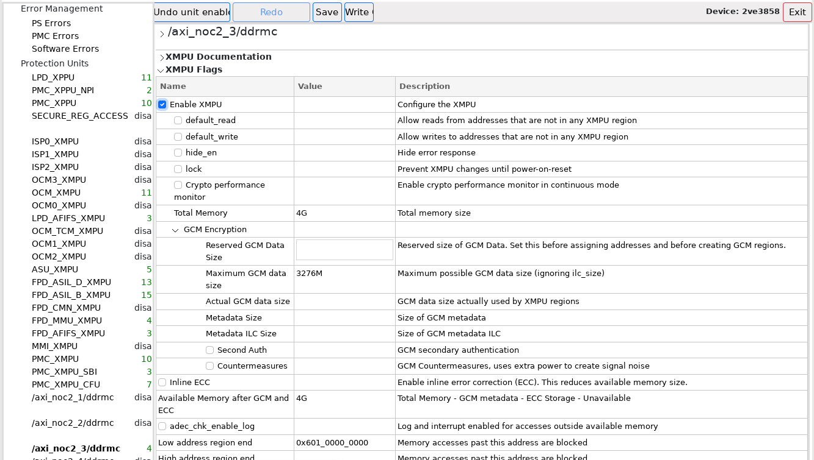

1. Scroll up on the left panel, and click on default under Subsystems as shown in the figure below.
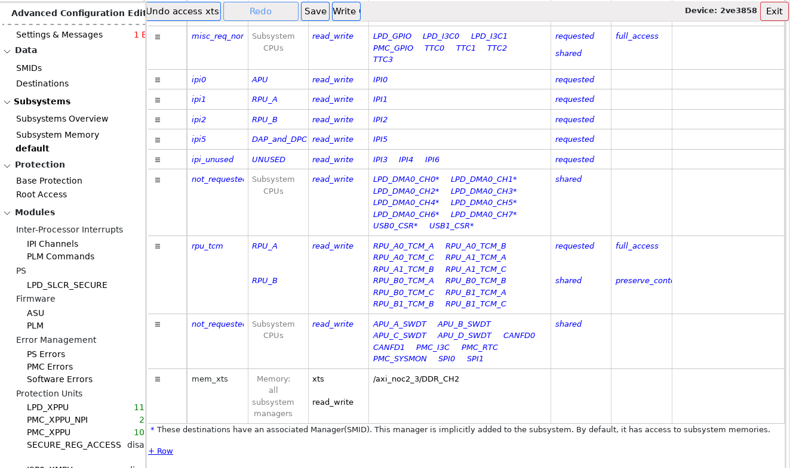

2. Scroll to the bottom of the main panel, and click on +Row.  A new row appears at the bottom with the name access_0.
3. Change the name from access_0 to mem_xts.
4. In the Destinations column of this row, click on the pen icon to open the 'Edit Destinations for Access /default/mem_xts window.  Scroll to the bottom and select the check box for /axi_noc2_3/DDR_CH2 as shown below.  Then click OK.
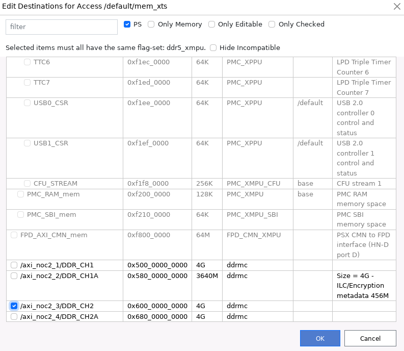
5. In the Access column of this row, click on the pen icon to open the Edit Flags window, and select xts under Encryption as shown below.  Then click OK.  You have now configured this memory controller for XTS-AES-256, and this should reduce the number of errors from 2 to 1.
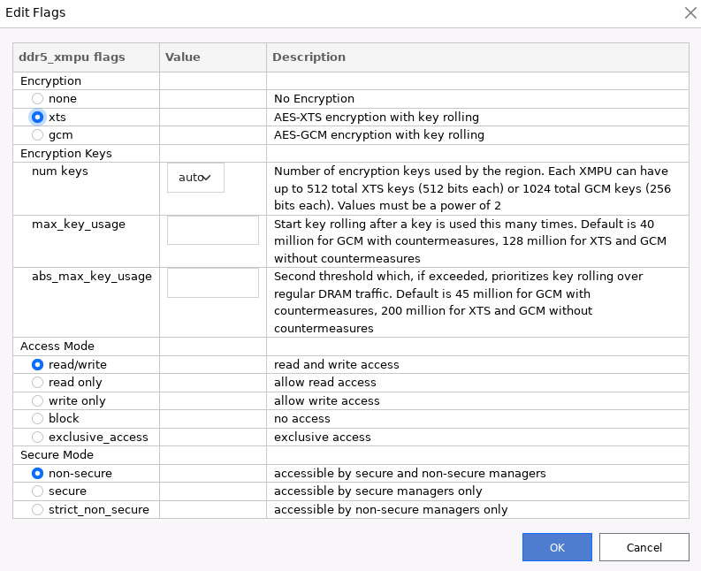
6. In the SMIDs column of this row, click on the pen icon to open the Edit Access mem_xts SMIDs window.  Deselect the checkbox that says Only Domain Managers to display all the SMIDs.  Now click the checkbox next to ANY and click OK.
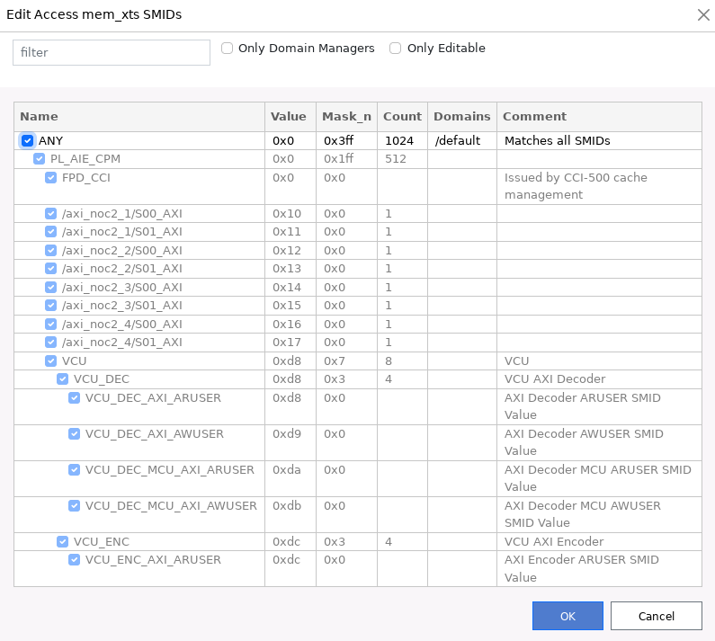

## Description of Configuration Options for XTS-AES-256
There are no XTS specific configuration settings because the metadata for XTS is stored in on-chip RAM hence no DRAM memory space is required.

## Configuring AES-GCM for /axi_noc2_4/ddrmc

Scroll to the bottom on the left panel, click on /axi_noc2_4/ddrmc, and then click on the Enable XMPU checkbox as shown below.
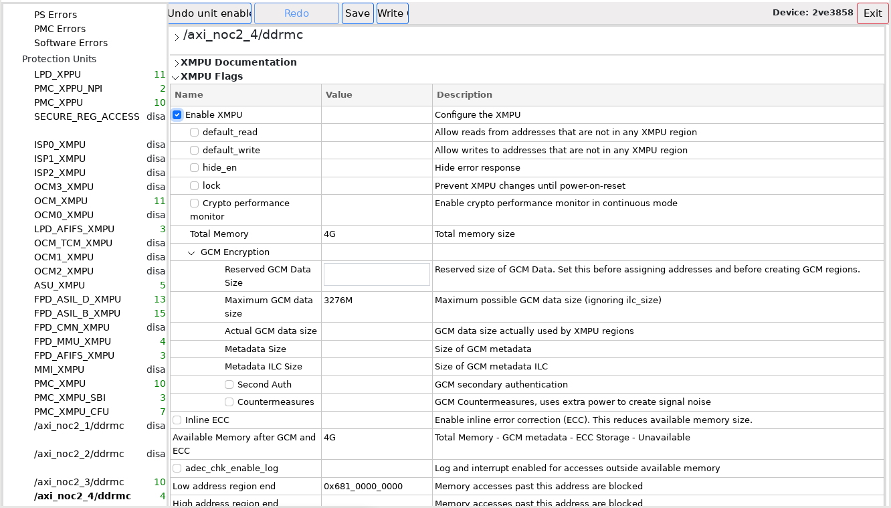

1. Scroll up on the left panel, and click on Destinations under Data as shown in the figure below.  Scroll to the bottom of the main panel and click on the + sign beside /axi_noc2_4/DDR_CH2A as shown in the figure below.
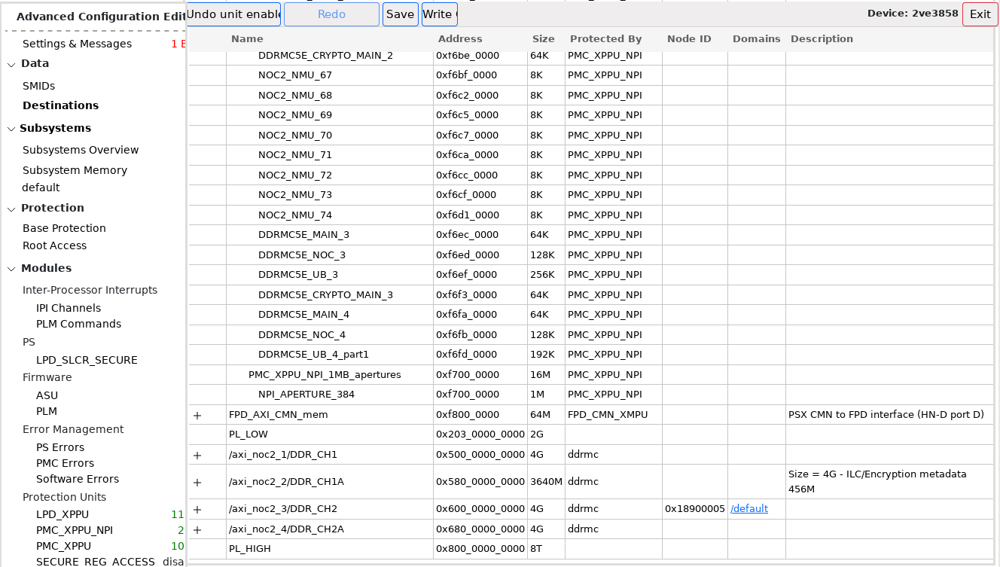

2. A new Add Destination window opens as shown below.  Type a name, e.g. mc_gcm, and change the size to 2G, or a value less than 3276MB (Maximum GCM data size).  Then click OK.
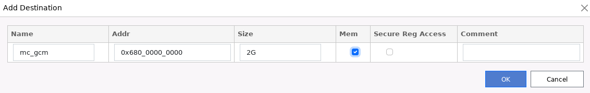

3. Scroll up on the left panel, and select default under Subsystems, as shown in the figure below.  Add a row, and change the name in the new row from access_0 to mem_gcm.
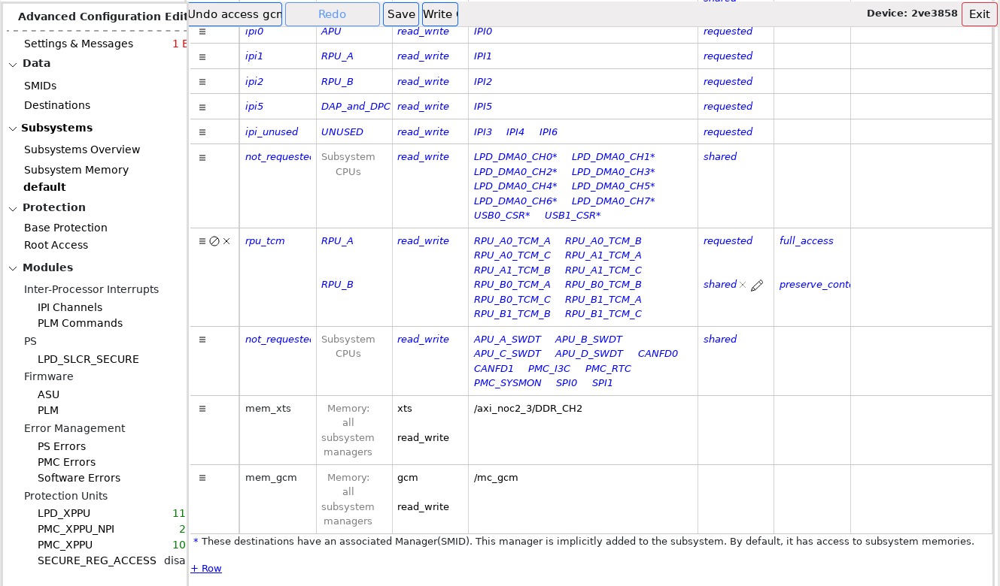

4. In the Destination column of this row, click on the pen icon to open the Edit Destinations for Access /default/mem_gcm window.  Scroll to the bottom and select the check box for mc_gcm under /axi_noc2_4/DDR_CH2A as shown below.  Then click OK.
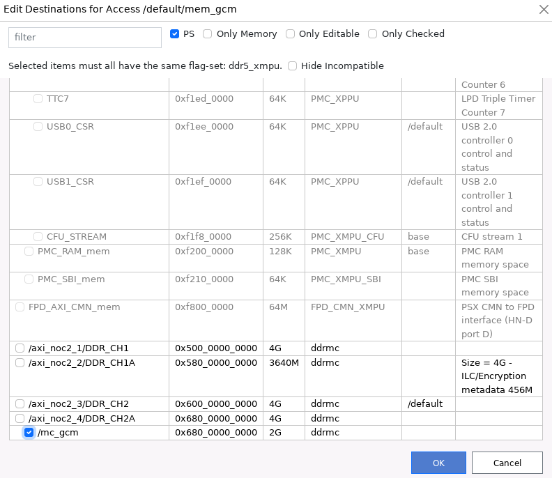

5. In the Access column of this row, click on the pen icon to open the Edit Flags window.  Select gcm under Encryption, as shown below, and then click OK.

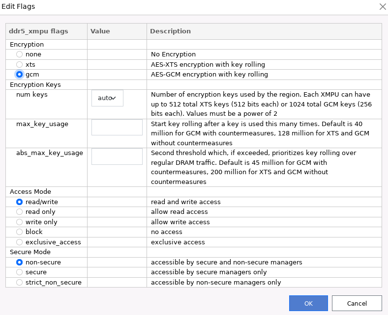

6. In the SMIDs column of this row, click on the pen icon to open the Edit Access mem_gcm SMIDs window.  Deselect the checkbox that says Only Domain Managers to display all the SMIDs.  Now click the checkbox next to ANY and click OK.


7. Scroll down to the bottom on left panel and click on /axi_noc2_4/ddrmc as shown in the figure below. In the ‘Reserved GCM Data Size’ field type in 2G and hit return. You have configured this memory controller for AES-GCM and the last error should be cleared.
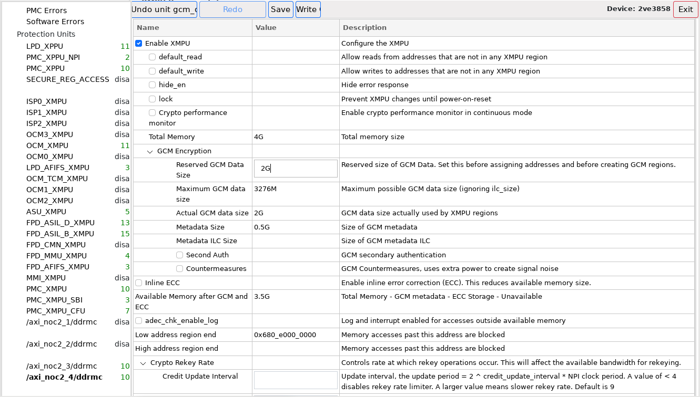

## Description of Configuration Options for AES-GCM

**Reserved GCM Data Size:** You can set this to be equal to or less than Maximum GCM data size, e.g. 3276M or 2G (as shown)

**Maximum GCM data size:** Total Memory – Metadata size – rounding error due to alignment restrictions = 4096 – (4096/8) – (rounding error) = 3584M – rounding error = 3276M

**Actual GCM data size:** Value that was assigned under Destinations in the Subsystem GUI

**Metadata Size:** GCM metadata is stored in DRAM memory and the size is (Total Memory)/8 = 4096/8 = 0.5G

**Metadata ILC Size:** When Inline ECC check box is selected, this is the size of Inline ECC metadata for GCM Metadata. Metadata size/8 = 512M/8 = 64M

**Second Auth:** When selected, the metadata is stored within the memory controller and not in off-chip DRAM thereby increasing security. Limited to 64M only

**Countermeasures:** Prevent decode of keys by adding extra noise. This increases power consumption.

**Available Memory after GCM and ECC:** (Total Memory – GCM Metadata Size – ECC storage (0, ILC not enabled) – Unavailable (0)) = 4096 – 512 = 3.5G

## Final PDI Generation with Overlay CDO for Hardware Download
After configuring the desired memory ranges for ILECC, XTS-AES-256, and AES_GCM in the Advanced Configuration Editor:
1. Click on the ‘Save’ button on the top to generate the isolation specification file (.iss).
2. Click on the ‘Write CDO’ button on the top to generate the overlay CDO file (.cdo).
3. Finally, click on the ‘Exit’ button on the top right corner.
4. Close the browser window.

The PDIs from Vivado will not be complete, because they will not include the ILECC and crypto configuration. It might not even be able to boot because the NoC is configured to use crypto/ILECC, but that is not yet integrated in the Vivado PDI. So, you need to generate new PDIs with the overlay CDO file by calling bootgen.
```csh
cd project_1.runs/impl_1/
bootgen -arch versal_2ve_2vm -image design_1_wrapper_boot.bif -w -o design_1_wrapper_boot_final.pdi -overlay_cdo ../../overlay.cdo
bootgen -arch versal_2ve_2vm -image design_1_wrapper_pld.bif -w -o design_1_wrapper_pld_final.pdi -overlay_cdo ../../overlay.cdo
```

The design_1_wrapper_boot_final.pdi and design_1_wrapper_pld_final.pld are the final PDIs that can be downloaded to hardware.

## Running the Design and Measuring Performance
Using Hardware Manager, connect to a VEK385 board and Program the device with the design_1_wrapper_boot_final.pdi and design_1_wrapper_pld_final.pdi you just created.

Launch xsdb, and run the following commands:
```tcl
conn
ta 1
cd ../../../../../scripts
source ./clear_and_start_noc_perf_mons_c0c1c2c3_continuous.tcl
```

Read and write bandwidth is measured for each channel of each memory controller, and the results are listed in MB/s.
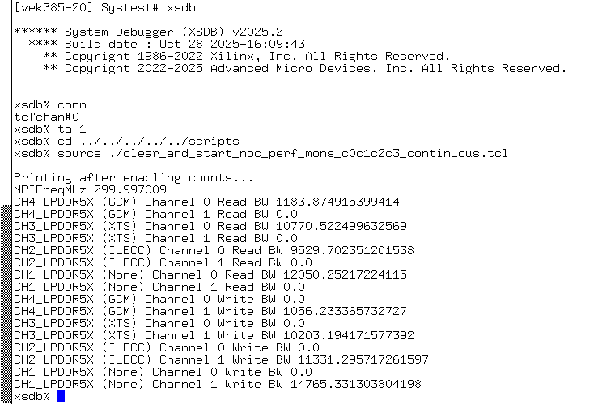
